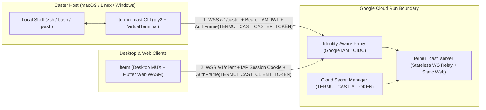
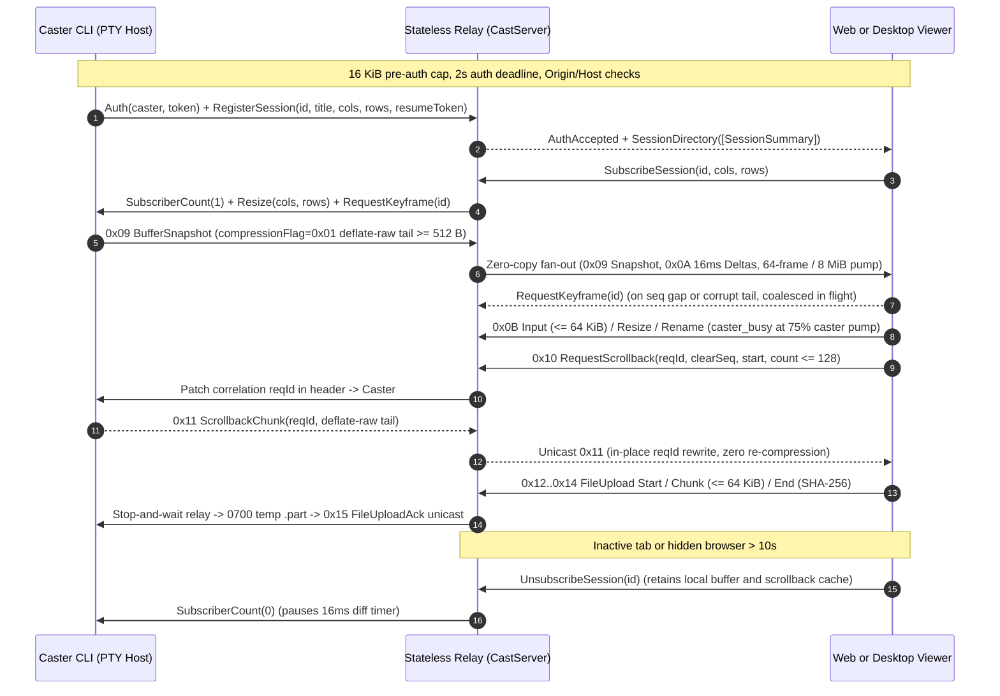

# TermUI Caster

> [!WARNING]
> **Remote Code Execution (RCE) Risk:** `termui_caster` opens live interactive shells (`zsh`, `bash`, `pwsh`) over WebSockets with **no** built-in identity provider or IAM layer. Exposing a TTY relay without strong perimeter authentication (such as Google Cloud IAM + Identity-Aware Proxy) grants full RCE on the casting host. Always deploy internet-facing relays behind Identity-Aware Proxy (`--iap`), store tokens in Secret Manager, and follow [docs/setup.md](docs/setup.md).

> [!NOTE]
> **Status: Active `0.x` Releases.** Current workspace versions are `fterm` `v0.5.0`, `termui_cast_client_core` `v0.4.0`, and `termui_cast_server` / `termui_caster_cli` / `termui_cast_protocol` `v0.3.0`. Breaking wire and API changes may still land between minor releases before `1.0.0`.

`termui_caster` streams live interactive TTY sessions over binary WebSockets across pure-Dart and Flutter workspace apps under `apps/`:

1. [caster_cli](caster_cli) (`termui_cast`): Spawns a local command with `package:pty2`, parses ANSI output into a `termui` `Buffer`, and streams `deflate-raw` snapshots and deltas with backpressure.
2. [server](server) (`termui_cast_server`): Routes live buffer, input, clipboard, audio, upload, and resize frames between peers with zero scrollback retention, and serves the WASM viewer at `/`.
3. [client_core](client_core) and [apps/fterm](../fterm): Powers both the `fterm` native desktop terminal multiplexer (`macos`, `linux`, `windows`) with local `PtyRouter` splits and optional per-pane relay broadcast, and the `fterm` Flutter WebAssembly browser viewer.

## Architecture and Trust Boundaries



### Wire Protocol and Packet Routing

See [SPEC.md](../SPEC.md) for the custom terminal escape sequences (audio, shaders, cell transforms, queries) and chunked file transfer (`0x12`–`0x15`) wire specification.



## Layout

| Path | Role |
| :--- | :--- |
| `apps/termui_cast/protocol` | Binary frame codec (`0x09` `BufferSnapshot`, `0x0A` `BufferDelta`, `0x11` `ScrollbackChunk` with `compressionFlag=0x01` `deflate-raw` tails), control messages, `dart:io` WebSocket adapter, and constant-time SHA-256 token verification |
| `apps/termui_cast/server` | Stateless `HttpServer` WebSocket relay (`--port 8420`, `/v1/caster`, `/v1/client`, `/healthz`) and static WASM web host behind TLS-terminating bastion |
| `apps/termui_cast/caster_cli` | `termui_cast` CLI (`pty2` + `VirtualTerminal` + jittered reconnect state machine + bounded uplink pump) |
| `apps/termui_cast/client_core` | Pure-Dart client transport, `CastClientRepository`, `RemoteTerminalPort`, `TerminalThemeSettings`, `FileUploadCoordinator`, and session sync state |
| `apps/fterm` | `fterm` Flutter desktop MUX & WASM web client (`TerminalSurface` splits sharing one `GlyphAtlas`, `PtyRouter` local shells, `Ctrl+\ b` pane share, `BEL`/`APC` audio) |
| `apps/termui_cast/docs/setup.md` | Deployment guide for Google Cloud Run with Identity-Aware Proxy (`--iap`) and self-hosted reverse proxies |

## Local Quickstart

Run all commands from the `termui` repository root after `flutter pub get`.

### 1. Start the Local Relay Server (Terminal 1)

On loopback (`127.0.0.1`), if `TERMUI_CAST_CASTER_TOKEN` or `TERMUI_CAST_CLIENT_TOKEN` are unset, `termui_cast_server` auto-mints 24-byte random tokens and prints them to stdout (unless `--insecure-no-auth` is passed explicitly). You can also set explicit tokens before starting:

**Linux / macOS (`bash` / `zsh`)**

```bash
export TERMUI_CAST_CASTER_TOKEN="dev-caster-local-token"
export TERMUI_CAST_CLIENT_TOKEN="dev-client-local-token"
dart run apps/termui_cast/server/bin/termui_cast_server.dart
```

**Windows (`PowerShell`)**

```powershell
$env:TERMUI_CAST_CASTER_TOKEN = "dev-caster-local-token"
$env:TERMUI_CAST_CLIENT_TOKEN = "dev-client-local-token"
dart run apps/termui_cast/server/bin/termui_cast_server.dart
```

### 2. Cast an Interactive Shell (Terminal 2)

**Linux / macOS (`bash` / `zsh`)**

```bash
export TERMUI_CAST_CASTER_TOKEN="dev-caster-local-token"
dart run apps/termui_cast/caster_cli/bin/termui_cast.dart --title "shell-1" -- zsh
```

**Windows (`PowerShell`)**

```powershell
$env:TERMUI_CAST_CASTER_TOKEN = "dev-caster-local-token"
dart run apps/termui_cast/caster_cli/bin/termui_cast.dart --title "pwsh-1" '--' powershell
```

### 3. Run `fterm` on Desktop or Chrome (Terminal 3)

On native desktop (`macos`, `linux`, `windows`), `fterm` opens a local interactive shell immediately on startup and connects to configured relays in the background without stealing tab focus. Press `Ctrl+\ b` on any local pane to publish it live to the relay (with self-cast `SessionId` filtering in the Session Picker). On Chrome/Web, `fterm` auto-populates relay session tabs and unlocks WebAudio on first gesture via [audio_unlock.js](../fterm/web/audio_unlock.js).

**Desktop (`macOS` / `Linux` / `Windows`)**

```bash
cd apps/fterm
TERMUI_CAST_SERVER_URL=ws://127.0.0.1:8420/v1/client \
TERMUI_CAST_TOKEN=dev-client-local-token \
TERMUI_CAST_CASTER_TOKEN=dev-caster-local-token \
flutter run -d macos
```

**Browser (`Linux` / `macOS`)**

```bash
cd apps/fterm
flutter run -d chrome \
  --dart-define=TERMUI_CAST_SERVER_URL=ws://127.0.0.1:8420/v1/client \
  --dart-define=TERMUI_CAST_TOKEN=dev-client-local-token
```

**Windows (`PowerShell`)**

```powershell
cd apps/fterm
flutter run -d chrome `
  --dart-define=TERMUI_CAST_SERVER_URL=ws://127.0.0.1:8420/v1/client `
  --dart-define=TERMUI_CAST_TOKEN=dev-client-local-token
```

### Reconnecting Dropped Casters (`SIGHUP` on macOS / Linux)

On macOS and Linux, `SIGHUP` shuts down `termui_cast` cleanly by default. Start `termui_cast` with `--keep-alive-on-hup` (or `TERMUI_CAST_KEEP_ALIVE_ON_HUP=true`) to make `SIGHUP` trigger an immediate reconnect and check-in instead. That mode re-registers the session after sleep or a network change while keeping the local shell and scrollback alive:

```bash
# Start with keep-alive enabled:
termui_cast --keep-alive-on-hup --title "shell-1" -- zsh

# Prebuilt binary bundle (`termui_cast`):
pkill -HUP -x termui_cast

# Running from source via `dart run`:
pgrep -fl termui_cast.dart
kill -HUP <pid>
```

Inspect PIDs with `pgrep -fl termui_cast.dart` before running `kill -HUP <pid>` so you do not signal `termui_cast_server` or an open editor.

## Building Standalone Binaries

`termui_cast` supports four native compilation targets: `macos-arm64`, `linux-x64`, `linux-arm64`, and `windows-x64`.

### Caster CLI (`termui_cast`) via `dart build cli`

`termui_caster_cli` uses `package:pty2`'s C build hook (`libpty2_unix.dylib` on macOS, `libpty2_unix.so` on Linux). Compile it on each target OS with `dart build cli` instead of `dart compile exe`:

```bash
dart build cli -t apps/termui_cast/caster_cli/bin/termui_cast.dart -o build/caster
```

This produces a self-contained directory bundle at `build/caster/bundle/` containing `bin/termui_cast` and `lib/libpty2_unix.{dylib,so}`. Keep `bin/` and `lib/` together in the same parent directory when distributing or installing the caster so `@rpath` resolves the native PTY library at runtime. On Windows, `termui_cast.exe` uses `conpty.dll` and `OpenConsole.exe` from the executable directory, `PTY2_CONPTY_DIR`, or the SHA-256-verified cache when `--download-conpty` (`$TERMUI_CAST_DOWNLOAD_CONPTY`) is enabled.

Prebuilt `fterm` desktop apps and `termui_cast` CLI/server archives are published through a two-step Melos release pipeline:

1. Run [`.github/workflows/release-fterm-prepare.yml`](../../.github/workflows/release-fterm-prepare.yml) (**Prepare fterm release**) to bump versions and generate `CHANGELOG.md` files across `apps/fterm` and `apps/termui_cast/*`, opening a `chore(fterm-release): ...` pull request. (If workspace dependencies under `packages/` also have pending changes, run **Prepare release** first.)
2. Merge that pull request into `main` to start [`.github/workflows/release-fterm.yml`](../../.github/workflows/release-fterm.yml) (**Release fterm**), which builds the WASM web viewer (`fterm-web.tar.gz`, pre-compressed as `.gz` assets with no uncompressed duplicates) once, packages `termui_cast_server-<os>-<arch>` (`bin/termui_cast_server` + `web/`, auto-discovered at `../web` on startup), packages lightweight `termui_cast-<os>-<arch>` caster archives (`bin/termui_cast` + PTY libraries), builds desktop `fterm` archives, tags `fterm-v<version>`, and publishes the GitHub Release.

Release binaries are unsigned. On macOS, run `xattr -dr com.apple.quarantine` on the extracted `fterm.app` or `termui_cast` directory before starting it. On Windows, keep `conpty.dll` and `OpenConsole.exe` next to `termui_cast.exe` (inside `bin/`) or `fterm.exe`, and choose **More info -> Run anyway** if SmartScreen prompts on first run.

### Relay Server (`termui_cast_server`) via `dart compile exe`

`termui_cast_server` has no native FFI hooks and compiles to a single standalone executable:

```bash
mkdir -p build
dart compile exe apps/termui_cast/server/bin/termui_cast_server.dart -o build/termui_cast_server
```

## Cloud Run + Identity-Aware Proxy Setup

See **[docs/setup.md](docs/setup.md)** for the complete production deployment walkthrough covering:

1. Cloud Build permissions (`roles/run.builder`).
2. Storing `TERMUI_CAST_CASTER_TOKEN` and `TERMUI_CAST_CLIENT_TOKEN` in **Secret Manager** (`--set-secrets`).
3. Deploying from the `termui` root with Google Cloud Buildpacks (`gcloud run deploy termui-cast --source .`).
4. Locking down ingress with **Identity-Aware Proxy (`--iap`)** and `roles/run.invoker`.
5. Provisioning per-host caster service accounts for keyless `gcloud` JWT signing (`TERMUI_CAST_IAP_SERVICE_ACCOUNT`) or pure-Dart local RS256 key signing (`TERMUI_CAST_IAP_KEY_FILE`).

For self-hosted deployments behind Tailscale Serve, `oauth2-proxy`, or Caddy on loopback, see **[Self-Hosted Reverse Proxy Setup](docs/setup.md#self-hosted-reverse-proxy-setup)**.

## Environment Variables Reference

All runtime environment variables use the `TERMUI_CAST_*` prefix.

| Variable | Component | Description |
| :--- | :--- | :--- |
| `TERMUI_CAST_CASTER_TOKEN` | Server & Caster CLI | Shared secret token required to register caster sessions (`/v1/caster`) |
| `TERMUI_CAST_CASTER_TOKEN_FILE` | Server & Caster CLI | Path to a UTF-8 file containing the `/v1/caster` bearer token |
| `TERMUI_CAST_CLIENT_TOKEN` | Server | Shared secret token required for viewer connections (`/v1/client`) |
| `TERMUI_CAST_CLIENT_TOKEN_FILE` | Server | Path to a UTF-8 file containing the `/v1/client` bearer token |
| `TERMUI_CAST_TRUST_PROXY_CLIENT_AUTH` | Server | Set to `true` or `1` to allow tokenless `/v1/client` upgrades behind perimeter auth |
| `TERMUI_CAST_REQUIRE_CLIENT_AUTH_HEADER` | Server | HTTP header required on `/v1/client` upgrades when proxy client auth is enabled (such as `X-Forwarded-Email`) |
| `TERMUI_CAST_BASE_PATH` | Server | URL subpath prefix (such as `/term`) for mounting relay endpoints and static web assets |
| `TERMUI_CAST_SERVER_URL` | Caster CLI & Web App | WebSocket endpoint URL (`wss://<host>/v1/caster` or `wss://<host>/v1/client`) |
| `TERMUI_CAST_TOKEN` | Web App (`--dart-define`) | Default viewer token embedded into the web viewer static bundle (public to anyone able to load static assets unless gated behind IAP; prefer `#token=...` fragments or perimeter auth) |
| `TERMUI_CAST_IAP_SERVICE_ACCOUNT` | Caster CLI | Service account email for keyless `gcloud iam service-accounts sign-jwt` IAP authentication |
| `TERMUI_CAST_IAP_KEY_FILE` | Caster CLI | Path to a service account JSON key for pure-Dart RS256 IAP authentication |
| `TERMUI_CAST_WEB_DIR` | Server | Directory path containing the compiled Flutter web assets (`build/web`) |
| `TERMUI_CAST_ALLOWED_ORIGINS` | Server | Comma-separated list of additional allowed `Origin` URLs for WebSocket upgrades (also permits matching `Host` headers on loopback) |
| `TERMUI_CAST_REVISION` | Server | Explicit revision string reported on `/healthz` (defaults to `K_REVISION` on Cloud Run) |
| `TERMUI_CAST_ALLOW_SPAWN` | Caster CLI | Set to `true`/`1` or `false`/`0` to control remote shell spawning (auto-enabled for interactive shells, off for non-shell commands) |
| `TERMUI_CAST_KEEP_ALIVE_ON_HUP` | Caster CLI | Set to `true` or `1` so `SIGHUP` reconnects and checks in instead of shutting down cleanly |
| `TERMUI_CAST_SCROLLBACK_LINES` | Caster CLI | Maximum scrollback ring buffer lines retained per session (default `5000`) |
| `TERMUI_CAST_DOWNLOAD_CONPTY` | Caster CLI (Windows) | Set to `true` or `1` to download the SHA-256-verified ConPTY bundle if missing |
| `TERMUI_CAST_UPLOAD` | Caster CLI | Enable (`true`) or disable (`false`) viewer-to-caster file uploads |
| `TERMUI_CAST_UPLOAD_DIR` | Caster CLI | Custom target directory for uploaded files |
| `TERMUI_CAST_MAX_UPLOAD_BYTES` | Caster CLI | Maximum file upload size in bytes (default `268435456` / 256 MiB) |

### Relay Server CLI Flags (`termui_cast_server`)

| Flag | Default | Description |
| :--- | :--- | :--- |
| `--host` | `127.0.0.1` (`0.0.0.0` when `$PORT` is set) | Bind address for HTTP and WebSocket connections |
| `--port`, `-p` | `8420` (or `$PORT`) | TCP port to listen on |
| `--caster-token` | `$TERMUI_CAST_CASTER_TOKEN` (auto-minted on loopback) | Shared secret token required for `/v1/caster` upgrades |
| `--caster-token-file` | `$TERMUI_CAST_CASTER_TOKEN_FILE` | File containing the `/v1/caster` bearer token |
| `--client-token` | `$TERMUI_CAST_CLIENT_TOKEN` (auto-minted on loopback) | Shared secret token required for `/v1/client` upgrades |
| `--client-token-file` | `$TERMUI_CAST_CLIENT_TOKEN_FILE` | File containing the `/v1/client` bearer token |
| `--insecure-no-auth` | `false` | Disable token authentication on loopback bindings (`127.0.0.1` / `::1` only) |
| `--trust-proxy-client-auth` | `false` (`$TERMUI_CAST_TRUST_PROXY_CLIENT_AUTH`) | Allow tokenless `/v1/client` upgrades behind perimeter auth; keeps `/v1/caster` token-gated |
| `--require-client-auth-header` | `$TERMUI_CAST_REQUIRE_CLIENT_AUTH_HEADER` | Require a non-empty HTTP header on `/v1/client` upgrades (requires `--trust-proxy-client-auth`) |
| `--base-path` | `""` (`$TERMUI_CAST_BASE_PATH`) | Mount `/healthz`, `/v1/caster`, `/v1/client`, and static assets under a URL subpath prefix (such as `/term`) |
| `--allowed-origin` | `$TERMUI_CAST_ALLOWED_ORIGINS` | Additional allowed `Origin` header URLs (repeatable; on loopback, also permits matching proxied `Host` headers) |
| `--web-dir` | `$TERMUI_CAST_WEB_DIR` (`apps/fterm/build/web`) | Directory of static WASM web viewer assets |
| `--no-web` | `false` | Disable static web asset serving at `/` |
| `--revision` | `$TERMUI_CAST_REVISION` (or `$K_REVISION`) | Server revision string reported on `/healthz` |

### Caster CLI Flags (`termui_cast`)

| Flag | Default | Description |
| :--- | :--- | :--- |
| `--server` | `ws://127.0.0.1:8420/v1/caster` (`$TERMUI_CAST_SERVER_URL`) | Relay server WebSocket URL (subpath URLs append `/v1/caster`) |
| `--token` / `--token-file` | `$TERMUI_CAST_CASTER_TOKEN` / `$TERMUI_CAST_CASTER_TOKEN_FILE` | Bearer token sent in the initial binary `AuthFrame` |
| `--title` | Executable basename | Tab label displayed in viewer clients |
| `--allow-spawn` / `--no-allow-spawn` | Auto (`true` for interactive shells, `false` otherwise; `$TERMUI_CAST_ALLOW_SPAWN`) | Allow viewers to remotely spawn additional shell PTYs in the same caster process |
| `--keep-alive-on-hup` | `false` (`$TERMUI_CAST_KEEP_ALIVE_ON_HUP`) | Reconnect and re-register on `SIGHUP` instead of shutting down cleanly |
| `--scrollback-lines` | `5000` (`$TERMUI_CAST_SCROLLBACK_LINES`) | Primary-screen scrollback lines retained in memory (`0..100000`) |
| `--upload` / `--no-upload` | `true` (`$TERMUI_CAST_UPLOAD`) | Allow or block browser drag-and-drop file uploads |
| `--upload-dir` | Host default (`$TERMUI_CAST_UPLOAD_DIR`) | Destination directory for uploaded files |
| `--max-upload-bytes` | `268435456` (`$TERMUI_CAST_MAX_UPLOAD_BYTES`) | Maximum size in bytes per uploaded file |
| `--iap-service-account` / `--iap-key-file` | `$TERMUI_CAST_IAP_SERVICE_ACCOUNT` / `$TERMUI_CAST_IAP_KEY_FILE` | Google Cloud IAP JWT signing via `gcloud` or a local service-account key file |
| `--download-conpty` | `false` (`$TERMUI_CAST_DOWNLOAD_CONPTY`) | Download SHA-256-verified ConPTY binaries on Windows if missing |

## Keyboard, Split, Audio, and Dock Controls

`fterm` uses a `Ctrl+\` leader chord on both Desktop and Web, plus native Desktop shortcuts (`Cmd+T/W/D/Shift+D/1..9` on macOS, `Ctrl+Shift+T/W/D/E` on Linux/Windows; left free for browser tabs on Web). Split panes share one `GlyphAtlas` texture, resize via smallest-viewport intersection across local and remote viewers, and pan `BEL` chimes plus `ESC _ A` (`APC A`) audio cues across the horizontal position of each pane. Standard keys such as `Ctrl+O` and `F12` pass directly to TUI programs (`nano`, `htop`, `vim`) unless host F12 shortcuts are enabled in Settings:

| Shortcut / Action | Description |
| :--- | :--- |
| `Ctrl+\ Ctrl+\` | Send literal `0x1c` (`FS`) to the focused PTY |
| `Ctrl+\ \|` / `Ctrl+\ %` | Split focused pane horizontally (`left \| right`) |
| `Ctrl+\ -` / `Ctrl+\ "` | Split focused pane vertically (`top / bottom`) |
| `Ctrl+\ h j k l` / `Arrows` | Move focus directionally across split panes |
| `Ctrl+\ z` | Toggle `tmux`-style fullscreen zoom on the focused pane |
| `Ctrl+\ b` | Toggle relay broadcast share on a local desktop pane (`killPty: false` on stop) |
| `Ctrl+\ c` | Open Sessions & Shells picker (local shells + non-self-cast remote relay sessions) |
| `Ctrl+\ n` / `p` / `1..9` | Switch to next / previous / numbered tab |
| `Ctrl+\ r` / Double-Click tab | Rename tab (pin custom title or check `Clear pin` to follow live shell titles) |
| `Ctrl+\ x` | Close focused pane or exited tab (`💀`) |
| `Ctrl+\ d` / `Space` | Cycle 28px Flutter tab bar (`top -> left -> hidden`; 0px bottom chrome) |
| `Ctrl+\ ,` | Open Settings (theme, contrast, dock, auto-hide single tab, audio mute/volume, `Reload from Storage`) |
| `Ctrl+\ i` | Open Stats overlay (relay state, bytes, bells/audio counts, shared viewers) |
| `Ctrl+\ ?` | Open Shortcuts Help overlay |
| `Cmd+T/W/D/Shift+D/1..9` | Native macOS desktop tab, close, split, and tab jump shortcuts |
| `Ctrl+Shift+T/W/D/E` | Native Linux / Windows desktop tab, close, and split shortcuts |
| `Drag` (`Alt+Drag` = box) | Select terminal text (stream or rectangular box mode) |
| `Mouse Wheel` | Scroll primary-screen history or alternate-screen `?1007h` scrollback |
| Drop files onto remote pane | Upload files (`<= 256 MiB`) to the active remote caster host |

## Security Notes (`0.x`)

- Locally, the relay binds to `127.0.0.1:8420` by default, or `0.0.0.0:$PORT` when `$PORT` is set.
- Loopback bindings auto-mint and print random `TERMUI_CAST_CASTER_TOKEN` and `TERMUI_CAST_CLIENT_TOKEN` values when unset. Passing `--insecure-no-auth` disables auto-minting for both tokens; passing `--trust-proxy-client-auth` skips `TERMUI_CAST_CLIENT_TOKEN` while still requiring or auto-minting `TERMUI_CAST_CASTER_TOKEN`.
- Non-loopback bindings require `--caster-token` (`$TERMUI_CAST_CASTER_TOKEN`) plus `--client-token` (unless `--trust-proxy-client-auth` is enabled), and reject `--insecure-no-auth` with exit code `64`.
- Loopback bindings reject non-loopback `Host` headers on WebSocket upgrades (`403 Forbidden`) to block DNS rebinding. Passing `--allowed-origin https://<public-host>` permits matching proxied `Host` headers (defaulting omitted ports to `443` or `80`, or matching an explicit port in `--allowed-origin`) while rejecting unlisted hosts.
- Passing `--trust-proxy-client-auth` allows tokenless `/v1/client` upgrades behind upstream perimeter auth while keeping `/v1/caster` token-gated. Pair it with `--require-client-auth-header` and block direct access to the relay port. See [Self-Hosted Reverse Proxy Setup](docs/setup.md#self-hosted-reverse-proxy-setup).
- Static web hosting negotiates `Accept-Encoding` (respecting `q=0`) and serves `.br` or `.gz` sidecars when present. Otherwise it caches in-memory `gzip` responses up to 32 MiB for compressible assets (`.wasm`, `.js`, `.mjs`, `.html`, `.json`, `.css`, `.svg`, `.ttf`, `.otf`) with `Vary: Accept-Encoding` and encoding-scoped ETags.
- On HTTP(S) origins without an explicit server URL, `fterm` Web attempts one silent tokenless same-origin connection before opening the connect dialog. Manually entered client tokens and open tab or split layouts persist only in tab-scoped `window.sessionStorage` (never `window.localStorage`), scoped to the matching relay URL.
- `termui_cast` enables remote shell spawning (`--allow-spawn`) automatically for recognized interactive shells and disables it for non-shell commands or scripts. Pass `--no-allow-spawn` to disable spawning on interactive shells.
- Pre-auth WebSocket upgrades enforce a 2-second auth deadline, a 16 KiB pre-auth cap, and oldest-pending eviction at 32 pending upgrades (`503` at 256 peers).
- Peers authenticate via an initial binary `AuthFrame` rather than URL query strings, and `termui_cast` strips all `TERMUI_CAST_*` variables from spawned child shell environments.
- Settings and saved relay credentials on native desktop live in `~/.config/fterm/settings.json` (`0700` directory, atomic `0600` POSIX temp-file write before rename) on macOS/Linux and `%APPDATA%\fterm\settings.json` on Windows.
- WebAudio unlock uses external [audio_unlock.js](../fterm/web/audio_unlock.js) with zero inline scripts for strict CSP compatibility.
- TLS terminates at the bastion or reverse proxy (such as Google Cloud Run + Identity-Aware Proxy, Tailscale Serve, `oauth2-proxy`, nginx, or Caddy). `termui_cast_server` binds plain HTTP/WS behind that perimeter rather than taking in-app TLS certificate flags.
- Web WASM builds compiled with `--dart-define=TERMUI_CAST_TOKEN=...` embed that token inside public static JS/WASM assets readable by anyone able to fetch `/`. Gate static asset hosting behind perimeter auth when baking a token, or pass tokens via `#token=...` fragments (scrubbed synchronously before WASM loads).

## Running Tests

```bash
dart analyze --fatal-infos
dart format --output=none --set-exit-if-changed apps
(cd apps/termui_cast/protocol && dart test)
(cd apps/termui_cast/server && dart test)
(cd apps/termui_cast/caster_cli && dart test)
(cd apps/termui_cast/client_core && dart test)
(cd apps/fterm && flutter test && flutter build web --wasm --no-web-resources-cdn)
```
