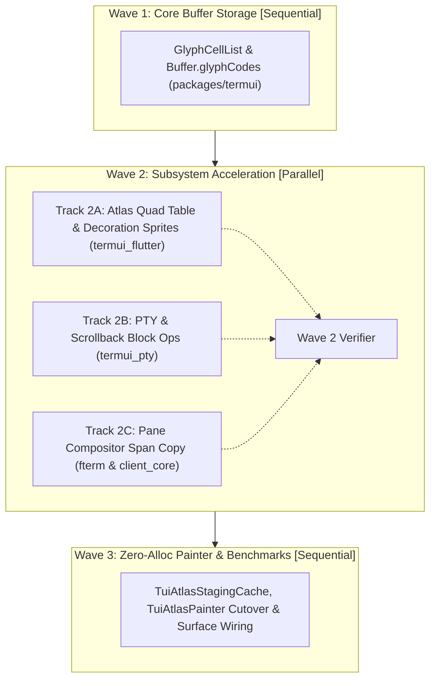

# Step 1: Optimized drawRawAtlas and Zero-Allocation CPU Staging

Eliminate per-frame Dart heap allocations, `String` pointer chasing, unbatched `Canvas` decoration passes, and clean-row re-staging in `TuiAtlasPainter` across Desktop and WebAssembly.

## User Review Required

> [!IMPORTANT]
> `Buffer.characters` stays typed as `List<String>` via `GlyphCellList extends ListBase<String>`, backed by a flat `Uint32List glyphCodes` array. Single-codepoint scalars (`1..0x10FFFF`) and wide continuations (`0`) live unboxed, while multi-codepoint clusters (`0x80000000 | id`) index a per-buffer table. Hot loops switch to `Uint32List` block copies (`setRange`, `fillRange`), preserving source compatibility for callers that index `buffer.characters[i]`.

## Open Questions

> [!NOTE]
> None currently blocking. Multi-codepoint cluster interning is bounded per `Buffer` and compacted automatically on `clear()` and `resize()`.

## Existing System Context & Constraints

- Melos workspace monorepo covering `packages/termui`, `packages/termui_pty`, `packages/termui_flutter`, `apps/termui_cast/*`, and `apps/fterm`.
- Targets Dart `>=3.11.0 <4.0.0` and Flutter `>=3.41.0` on Desktop (`macos`, `linux`, `windows`) and Web (`wasm`).
- `termui` owns `Buffer` cell storage (`GlyphCellList`, `Uint32List glyphCodes`) and zero-allocation ASCII/Unicode cell writes.
- `termui_pty` owns `VirtualTerminal`, `TerminalView`, and `ScrollbackLine` `Uint32List` copy and fill fast paths.
- `termui_flutter` owns `GlyphAtlas` flat `Float32List` quad tables, pre-baked decoration sprites, `TuiAtlasStagingCache`, and out-of-paint IME `TextPainter` caching.
- `termui_cast_client_core` and `fterm` own `FtermPaneController` and `WorkspaceBufferCompositor` `glyphCodes` span composition.
- `Buffer.characters` (`List<String>`) and `Buffer.attributes` (`Uint32List`) must stay valid for callers that mutate raw 1D arrays directly.
- All functions must stay at or below SonarSource cognitive complexity `15` with zero `dynamic` tokens.
- Non-goals: custom `ui.FragmentShader` effects (`docs/plans/step2_fragment_shader_effects_issue_364_plan.md`), `flutter_gpu`, and Bezier rendering via Slug.

## Target Architecture & Wave Topology

`TuiAtlasPainter` currently walks every cell on every frame, chasing `String` pointers and allocating 6 scratch `List`s plus `_CellDecoration` and `_ItalicAtlasCell` objects. It also breaks batching via per-cell `canvas.drawLine` and `Path.quadraticBezierTo` calls.

The target pipeline stores scalar code points unboxed in `Uint32List` and bakes all underline and strikethrough styles into `GlyphAtlas` as modulation sprites. It reads glyph UV quads from a flat `Float32List` and hashes contiguous row words so clean rows skip sprite staging.



### Orchestration & Parallel Verification Matrix

| Wave / Track | Execution Mode | Orchestrator / Role | Workspace Isolation | Owned Files / Scope | Verification Gate |
| :--- | :--- | :--- | :--- | :--- | :--- |
| **Wave 1** | Sequential | Coordinator / Single Agent | Primary workspace | `packages/termui/lib/ui/**`, `packages/termui/test/**` | `dart test` & `dart analyze --fatal-infos` in `packages/termui` |
| **Track 2A** | Parallel (Wave 2) | `/swarm` author (`atlas`) | `workspace: "share"` | `atlas_quad_table.dart`, `atlas.dart`, `atlas_controller.dart` | `flutter test test/atlas_decoration_sprites_test.dart` |
| **Track 2B** | Parallel (Wave 2) | `/swarm` author (`pty`) | `workspace: "share"` | `packages/termui_pty/lib/src/**`, `packages/termui_pty/test/**` | `dart test test/glyph_codes_pty_test.dart` |
| **Track 2C** | Parallel (Wave 2) | `/swarm` author (`compositor`) | `workspace: "share"` | `fterm_pane_controller.dart`, `workspace_buffer_compositor.dart` | `flutter test test/pane_recomposite_glyph_codes_test.dart` |
| **Wave 2 Verifier** | Parallel Critic | `/swarm` `verifier` | `workspace: "inherit"` | Audits Wave 2 file boundaries & complexity `<= 15` | Cross-package `dart analyze --fatal-infos` |
| **Wave 3** | Sequential | Coordinator / Single Agent | Primary workspace | `staging_cache.dart`, `painter.dart`, `terminal_surface.dart`, exports, benchmarks | Full `termui_flutter` & `fterm` test + benchmark suites |

### Interface & Schema Specifications

```dart
// packages/termui/lib/ui/glyph_cell_list.dart
final class GlyphCellList extends ListBase<String> {
  static const int clusterFlag = 0x80000000;
  static const int payloadMask = 0x7FFFFFFF;
  static const int wideContinuationCode = 0;
  static const int spaceCode = 0x20;

  final Uint32List codes;

  GlyphCellList.filled(int length, {int fillCode = spaceCode});

  int encodeGrapheme(String grapheme);
  String decodeCode(int packedCode);
  void copyCellsFrom(GlyphCellList source, int dstStart, int srcStart, int count);
  void compactClustersIfSparse();
}

// packages/termui_flutter/lib/src/rendering/atlas_quad_table.dart
enum AtlasDecorationKind {
  overline,
  strikethrough,
  underlineSingle,
  underlineDouble,
  underlineCurly,
  underlineDotted,
  underlineDashed,
}

final class AtlasQuadTable {
  /// Packed `[left, top, right, bottom]` physical texel coordinates (`4` floats per entry).
  final Float32List ltrbQuads;

  /// Returns `quadIndex * 4` into [ltrbQuads], or `-1` when absent.
  int quadOffsetForCode(int packedGlyphCode, {required int variantBits});

  /// Returns `quadIndex * 4` into [ltrbQuads] for procedural cell decorations.
  int decorationQuadOffset(AtlasDecorationKind kind, {required bool isWide});
}

// packages/termui_flutter/lib/src/rendering/staging_cache.dart
final class TuiAtlasStagingCache {
  int computeRowFingerprint({
    required Buffer buffer,
    required int row,
    required int selectionHash,
    required int hoveredLinkHash,
    required int configHash,
  });

  void ensureGridCapacity(int cols, int rows);
  void invalidateAllRows();
}
```

## Migration & Execution Phases

### Wave 1: Compatibility Shims & Shared Contracts [Sequential]

Replace heap-allocated `List<String>` storage in `Buffer` with `GlyphCellList` while preserving `List<String>` compatibility for existing callers.

- [ ] [NEW] [glyph_cell_list.dart](packages/termui/lib/ui/glyph_cell_list.dart)
  - Implement `GlyphCellList extends ListBase<String>` over `Uint32List codes` with a static ASCII `List<String>` table (`0x00..0x7F`) for zero-allocation single-byte reads.
  - Maintain a deduplicated `_clusterStrings` / `_clusterIds` side table for multi-codepoint clusters (`clusterFlag | id`).
  - Override `setRange` and `fillRange` so `GlyphCellList` copies run `codes.setRange(...)` directly and `' '` / `''` fills run `codes.fillRange(...)`.
- [ ] [MODIFY] [buffer.dart](packages/termui/lib/ui/buffer.dart)
  - Back `characters` with `GlyphCellList _glyphCells`, and expose `Uint32List get glyphCodes` and `GlyphCellList get glyphCellList`.
  - Update `_resetCell`, `_writeAsciiString`, `_writeStyledCellRaw`, `clear`, `fillRect`, and `resize` to write scalar integers directly into `glyphCodes`.
- [ ] [MODIFY] [termui.dart](packages/termui/lib/termui.dart)
  - Export `ui/glyph_cell_list.dart` so `termui_pty` and `termui_flutter` consume `GlyphCellList` from the main entrypoint.
- [ ] [NEW] [glyph_cell_list_test.dart](packages/termui/test/glyph_cell_list_test.dart)
  - Test round-trip encoding for `''` (`0`), `' '` (`0x20`), SMP scalars (`0x1F680`), ZWJ sequences (`👨‍👩‍👧`), VS16 selectors, and Kitty placeholders.
  - Verify `setRange` cross-buffer cluster remapping and cluster compaction on `clear()`.

**Wave 1 Verification**: `cd packages/termui; dart format --output=none --set-exit-if-changed .; dart analyze --fatal-infos; dart test`

______________________________________________________________________

### Wave 2: Core Subsystem Migration [Parallel]

Upgrade atlas lookup tables, PTY terminal buffers, and `fterm` pane composition in parallel across disjoint packages.

#### Track 2A: Atlas Quad Table & Pre-Baked Decoration Sprites

- **Depends on**: Wave 1
- **Owns**: `packages/termui_flutter/lib/src/rendering/atlas_quad_table.dart`, `packages/termui_flutter/lib/src/rendering/atlas.dart`, `packages/termui_flutter/lib/src/rendering/atlas_controller.dart`, `packages/termui_flutter/test/atlas_decoration_sprites_test.dart`
- **Must Not Touch**: `packages/termui_flutter/lib/src/rendering/painter.dart`, `packages/termui_flutter/lib/src/terminal_surface.dart`, `packages/termui_flutter/lib/termui_flutter.dart`

- [ ] [NEW] [atlas_quad_table.dart](packages/termui_flutter/lib/src/rendering/atlas_quad_table.dart)
  - Implement `AtlasDecorationKind` and `AtlasQuadTable` over `Float32List ltrbQuads` with `Int32List` tables for ASCII (`0x20..0x7E`), Box/Block (`0x2500..0x259F`), and Braille (`0x2800..0x28FF`).
  - Add a power-of-two open-addressed hash table mapping `(codePoint, variantBits)` to quad offsets without boxing records.
- [ ] [MODIFY] [atlas.dart](packages/termui_flutter/lib/src/rendering/atlas.dart)
  - Rasterize 1-cell and 2-cell white (`0xFFFFFFFF`) sprites for all 7 `AtlasDecorationKind` values in `GlyphAtlasGenerator.generate` and preserve them across `addStyledGlyphs`.
  - Populate and expose `AtlasQuadTable get quadTable` on `GlyphAtlas` alongside existing `rectFor` APIs.
- [ ] [MODIFY] [atlas_controller.dart](packages/termui_flutter/lib/src/rendering/atlas_controller.dart)
  - Update `ensureFallbackPaintersForBuffer` to scan `buffer.glyphCodes` directly, skipping `0`, `0x20`, Kitty placeholders, and `quadTable` hits without decoding `String`s.
- [ ] [NEW] [atlas_decoration_sprites_test.dart](packages/termui_flutter/test/atlas_decoration_sprites_test.dart)
  - Verify pixel coverage and quad bounds for all 14 decoration sprites across DPR `1.0` and `2.0`, plus `quadOffsetForCode` parity with `rectFor`.

**Track 2A Verification**: `cd packages/termui_flutter; dart format --output=none --set-exit-if-changed lib/src/rendering/atlas_quad_table.dart lib/src/rendering/atlas.dart lib/src/rendering/atlas_controller.dart test/atlas_decoration_sprites_test.dart; flutter analyze --no-pub; flutter test test/atlas_decoration_sprites_test.dart test/atlas_multi_style_ligatures_test.dart`

#### Track 2B: PTY & Scrollback `glyphCodes` Block Operations

- **Depends on**: Wave 1
- **Owns**: `packages/termui_pty/lib/src/scrollback_buffer.dart`, `packages/termui_pty/lib/src/virtual_terminal.dart`, `packages/termui_pty/lib/src/terminal_view.dart`, `packages/termui_pty/test/glyph_codes_pty_test.dart`
- **Must Not Touch**: `packages/termui/**`, `packages/termui_flutter/**`, `apps/**`

- [ ] [MODIFY] [scrollback_buffer.dart](packages/termui_pty/lib/src/scrollback_buffer.dart)
  - Store `GlyphCellList` inside `ScrollbackLine` while keeping `List<String> get characters` compatible, avoiding per-column `String` list allocation on scroll-up.
- [ ] [MODIFY] [virtual_terminal.dart](packages/termui_pty/lib/src/virtual_terminal.dart)
  - Switch scroll shifts, `ED`/`EL` erases, ASCII run printing, and screen copies to `glyphCellList.copyCellsFrom` and `glyphCodes.fillRange`.
- [ ] [MODIFY] [terminal_view.dart](packages/termui_pty/lib/src/terminal_view.dart)
  - Replace `buffer.characters.setRange` and `fillRange` during scrollback rendering with `glyphCellList.copyCellsFrom` and `glyphCodes.fillRange`.
- [ ] [NEW] [glyph_codes_pty_test.dart](packages/termui_pty/test/glyph_codes_pty_test.dart)
  - Test scrollback eviction, wide CJK split clearing, ZWJ emoji preservation across scroll-up and resize, and `ED`/`EL` blanking via `glyphCodes`.

**Track 2B Verification**: `cd packages/termui_pty; dart format --output=none --set-exit-if-changed .; dart analyze --fatal-infos; dart test test/glyph_codes_pty_test.dart test/virtual_terminal_test.dart test/scrollback_viewport_test.dart`

#### Track 2C: `fterm` & `client_core` Pane Compositor Fast-Path

- **Depends on**: Wave 1
- **Owns**: `apps/fterm/lib/src/workspace/fterm_pane_controller.dart`, `apps/termui_cast/client_core/lib/src/workspace_buffer_compositor.dart`, `apps/fterm/test/pane_recomposite_glyph_codes_test.dart`
- **Must Not Touch**: `packages/**`, `apps/fterm/lib/src/ui/**`

- [ ] [MODIFY] [fterm_pane_controller.dart](apps/fterm/lib/src/workspace/fterm_pane_controller.dart)
  - Update `_copyResolvedCells`, `_copyLiveRow`, `_copyScrollbackRow`, and `_clearScreenRow` to copy `src.glyphCellList` spans and fill empty rows via `glyphCodes.fillRange`.
- [ ] [MODIFY] [workspace_buffer_compositor.dart](apps/termui_cast/client_core/lib/src/workspace_buffer_compositor.dart)
  - Avoid intermediate `sublist` allocation on clean ASCII link-lookup lines when scanning virtual lines.
- [ ] [NEW] [pane_recomposite_glyph_codes_test.dart](apps/fterm/test/pane_recomposite_glyph_codes_test.dart)
  - Verify incremental `dirtySpans` recomposition, cursor cell restore, scrollback row blending, and multi-codepoint grapheme preservation in `FtermPaneController`.

**Track 2C Verification**: `cd apps/fterm; dart format --output=none --set-exit-if-changed lib/src/workspace/fterm_pane_controller.dart test/pane_recomposite_glyph_codes_test.dart; flutter analyze --no-pub; flutter test test/pane_recomposite_glyph_codes_test.dart test/split_tree_and_workspace_test.dart`

**Wave 2 Verifier & Barrier Gate**:
- Peer `verifier` audits Tracks 2A, 2B, and 2C for zero file overlap, zero `dynamic` tokens, and cognitive complexity `<= 15`.
- Wave barrier command: `cd packages/termui_pty; dart test; cd ../termui_flutter; flutter test; cd ../../apps/fterm; flutter test`

______________________________________________________________________

### Wave 3: Cutover, Chokepoint Wiring & Cleanup [Sequential]

Cut `TuiAtlasPainter` over to `TuiAtlasStagingCache` and `AtlasQuadTable`, hoist IME `TextPainter` layout out of `paint()`, and wire benchmarks.

- [ ] [NEW] [staging_cache.dart](packages/termui_flutter/lib/src/rendering/staging_cache.dart)
  - Implement `TuiAtlasStagingCache` owning persistent bg, fg, and emoji `Float32List` / `Int32List` buffers, per-row offsets, and 64-bit row fingerprints.
  - Mix `glyphCodes`, `attributes`, `underlineColors`, selection bounds, hovered link bounds, `atlas.image` identity, and theme colors into each row fingerprint.
  - Replace `_CellDecoration`, `_ItalicAtlasCell`, and per-frame `List` allocations with reusable typed arrays, and compact clean-row slices via `setRange`.
- [ ] [MODIFY] [painter.dart](packages/termui_flutter/lib/src/rendering/painter.dart)
  - Accept optional `TuiAtlasStagingCache? stagingCache` and `TextPainter? composingPainter`.
  - Stage all underline styles, overlines, and strikethroughs into `_transformsFg` via `atlas.quadTable.decorationQuadOffset(...)`, deleting `_paintDecorations` and `_drawCurlyLine`.
  - Read glyph quads via `atlas.quadTable.quadOffsetForCode(...)` over `buffer.glyphCodes` instead of `Map<String, Rect>` lookups.
  - Paint `composingPainter` directly in `_paintComposingOverlay` instead of calling `TextPainter.layout()` inside `paint()`.
- [ ] [MODIFY] [terminal_surface.dart](packages/termui_flutter/lib/src/terminal_surface.dart)
  - Own one `TuiAtlasStagingCache _stagingCache` per `TerminalSurfaceState` so `setState()` rebuilds reuse staged GPU batch arrays.
  - Cache `TextPainter? _composingPainter` across frames, updating only on IME text, font, or theme changes, and dispose on unmount.
  - Update `_KittyGpuImageCache.ensureForBuffer` to scan `buffer.glyphCodes` and `buffer.attributes` without dereferencing non-cluster `String`s.
- [ ] [MODIFY] [termui_flutter.dart](packages/termui_flutter/lib/termui_flutter.dart)
  - Export `TuiAtlasStagingCache` and `AtlasDecorationKind` for custom embedders and benchmark harnesses.
- [ ] [MODIFY] [benchmark_main.dart](packages/termui_flutter/example/lib/benchmark_main.dart)
  - Add `TuiAtlasPainter` modes (200x60 1-row tail log, cursor blink, curly-underline diagnostics, and CJK/NerdFont redraw) with `Tracer` spans.
- [ ] [NEW] [painter_row_cache_test.dart](packages/termui_flutter/test/painter_row_cache_test.dart)
  - Assert hit and miss counts on the row cache when mutating 1 row of a 200x60 `Buffer`.
  - Verify immediate invalidation on raw `buffer.attributes[...]` writes, selection drags, rainbow hover ticks, and palette switches, plus underline golden parity.

**Wave 3 Verification**: `cd packages/termui_flutter; dart format --output=none --set-exit-if-changed .; flutter analyze --no-pub; flutter test; cd ../../apps/fterm; flutter analyze --no-pub; flutter test`

______________________________________________________________________

## Verification Plan

### Automated Regression & Integration Tests

- Core buffer suite: `cd packages/termui; dart test`
- PTY & scrollback suite: `cd packages/termui_pty; dart test`
- Flutter renderer & golden suite: `cd packages/termui_flutter; flutter test`
- `fterm` workspace & pane suite: `cd apps/fterm; flutter test`
- Workspace static analysis: `dart format --output=none --set-exit-if-changed .; dart analyze --fatal-infos`

### Edge Cases & Failure Scenarios

1. Mutating `buffer.attributes[idx * 3] = 0xFFFF0000` directly must change that row's 64-bit fingerprint and re-stage the row with zero stale cells.
2. Overwriting half of a 2-cell CJK character or ZWJ emoji (`0` continuation code) must clear the partner cell in both `glyphCodes` and staged sprites.
3. With `enableBleed: true`, mutating row `y` must re-evaluate row `y + 1`'s `_hasNonDefaultBgPredecessor` mask when row `y`'s background mask changes.
4. Triggering `TerminalSurfaceState.setState` (such as an `OSC 22` cursor change) must preserve `_stagingCache` without reallocating `Float32List` buffers.
5. SGR 58 custom underline colors and `HoveredLinkCellStyles` rainbow overrides must tint the underline sprite independently from glyph foreground color.

### Performance & Complexity Audit

- Run `cd apps/fterm; flutter test test/pane_recomposite_benchmark.dart` and profile `packages/termui_flutter/example/lib/benchmark_main.dart` with `Tracer`.
- Target 200x60 metrics: `<= 0.08 ms` CPU paint for 1-row updates, `<= 0.40 ms` for full dirty redraws, and `0` `Path` allocations on curly underlines.
- Verify all new and modified functions score `<= 15` using the `cognitive-complexity` analyzer.

## Rollback & Disaster Recovery Plan

1. Rollback trigger: visual golden mismatch on underlines, wide emojis, or Web `enableBleed` seams, or any regression in `pane_recomposite_benchmark.dart`.
2. Rollback steps: pass `stagingCache: null` in `TerminalSurface` to bypass row caching while bisecting, or revert Wave 3 (`painter.dart`, `staging_cache.dart`, `terminal_surface.dart`) cleanly.
