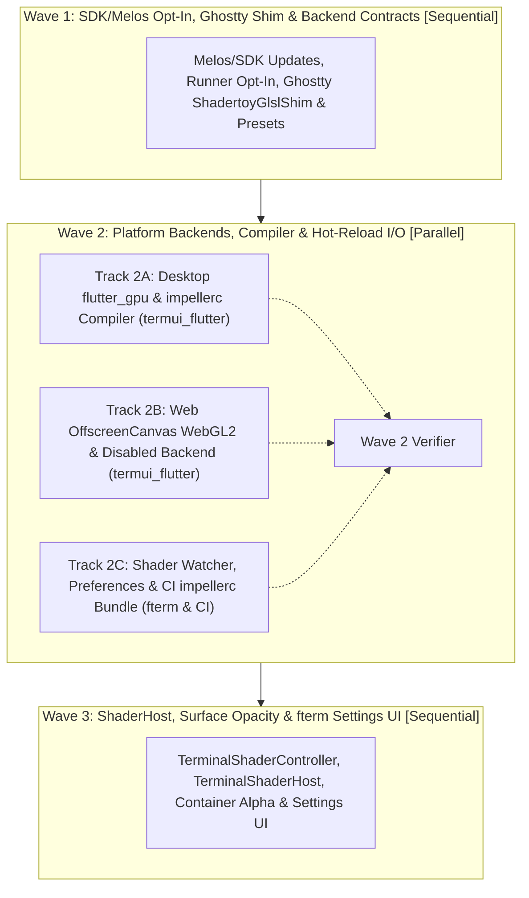

# Step 2: Unified Custom Shader Engine & Ghostty/Kitty Hot-Reload (Issue #364)

Add user-authored background and foreground shaders, wallpapers, and live hot-reload across Desktop (`flutter_gpu` + bundled `impellerc`) and Web (`OffscreenCanvas` WebGL2). Match Ghostty's Shadertoy GLSL prefix verbatim and add Kitty-inspired multi-pass persistence.

## User Review Required

> [!IMPORTANT]
> `termui_flutter` introduces a unified `TerminalShaderBackend` with three states: `flutterGpu` (Desktop Impeller + `ShaderLibrary.fromBytes` / `reinitializeFromBytes` + bundled `impellerc` `5.8` to `11 MB`), `webGl2` (PlatformView-free `OffscreenCanvas` WebGL2 on Flutter Web), and `disabled`. Skia Desktop and software rendering (such as `flutter test`) are intentionally unsupported and report `ShaderBackendKind.disabled` (`glsl=0` on `a=query`) without calling Impeller-only `ui.ImageFilter.shader`. Experimental Impeller on Web (WIMP) can slot behind `TerminalShaderBackend` once it stabilizes.

> [!WARNING]
> Adding `flutter_gpu: { sdk: flutter }` raises `packages/termui_flutter` and `apps/fterm` to Flutter `>=3.50.0` / Dart `>=3.13.0`, removes `melos.command.bootstrap.environment` from root `pubspec.yaml`, and opts Desktop runners into Flutter GPU (`FLTEnableFlutterGPU` on macOS, `fl_dart_project_set_enable_flutter_gpu` on Linux, and `project.set_enable_flutter_gpu(true)` on Windows). Impeller is already enabled by default on all three desktop platforms in Flutter 3.50. Pure-Dart packages (`termui`, `termui_pty`) stay on Dart `>=3.11.0`.

## Open Questions

> [!NOTE]
> All architecture decisions are resolved in [open_questions.md](open_questions.md). Remaining CI tasks test the Windows runner flag, macOS ad-hoc `codesign --verify --deep --strict`, Android builds, and WebGL2 uploads.

## Existing System Context & Constraints

- Melos monorepo spanning root `pubspec.yaml`, `packages/termui`, `packages/termui_flutter`, `apps/termui_cast/client_core`, `apps/fterm`, `AGENTS.md`, and `.github/workflows/release-fterm.yml`.
- `termui` (pure Dart `>=3.11.0`) defines `ShaderAnimationMode` so `client_core`, `termui_flutter`, and `fterm` share one enum without pulling Flutter into `client_core`.
- `termui_flutter` owns Ghostty-compatible built-in presets, `ShadertoyGlslShim`, `TerminalShaderBackend` (`flutter_gpu` Desktop, `OffscreenCanvas` WebGL2 Web, and `disabled`), `ImpellercCompiler`, `TerminalShaderController`, leaf `TerminalShaderHost`, and `backgroundOpacity` alpha support in `TerminalSurface` and `TuiAtlasPainter`.
- `termui_cast_client_core` owns `backgroundOpacity`, shader chain paths, and `ShaderAnimationMode` persistence in `TerminalThemeSettings`.
- `fterm` owns async wallpaper and shader loading, `~/.config/fterm/shaders/` directory watching, `Ctrl+Shift+F5` manual shader reload, `shaderBackendOverride`, compile error banners, and Settings UI controls in `fterm_overlays.dart`.
- `release-fterm.yml` bundles `impellerc` (`impellerc.exe` on Windows) before `.fterm-files.json` generation and ad-hoc re-signs `fterm.app` on macOS so `update_service_io.dart`'s `codesign --verify --deep --strict` verification passes. Dev `flutter run` builds fall back to the local Flutter SDK cache.
- Shortcut hygiene: `Cmd+,` (macOS) and `Ctrl+Shift+,` (Linux/Windows) already open Settings in `fterm_shortcut_dispatcher.dart`. Bind manual shader reload to `Ctrl+Shift+F5` across all desktop platforms to avoid conflicts.
- Animated `iTime` ticks must drive a leaf `ChangeNotifier` (`markNeedsPaint()` only) and respect `ShaderAnimationMode` (`always`, `focused`, `onActivity`, `staticOnly`).
- Non-goals in Step 2: Skia Desktop or software-rendered shaders, CLI-emitted `ESC _ S` custom shaders, per-cell transforms, scoped `ShaderRegion` ("word on fire"), and `termui_cast` `0x1C` forwarding (all in [step3_cli_artistic_shaders_and_transforms_plan.md](step3_cli_artistic_shaders_and_transforms_plan.md)).

## Target Architecture & Wave Topology

User shaders use Ghostty's verbatim Shadertoy GLSL contract (`void mainImage(out vec4 fragColor, in vec2 fragCoord)` plus Ghostty's `shadertoy_prefix.glsl` uniforms). `ShadertoyGlslShim` wraps one `.glsl` file into two targets with explicit per-backend UV V-flip wrappers (`IMPELLER_TARGET_OPENGLES` vs Metal/Vulkan/WebGL2):

- Desktop (`flutter_gpu`): `#version 460 core` fragment + full-screen triangle vertex shader compiled out-of-process via `impellerc --shader-bundle='<inline-json>' --sl=<out.shaderbundle> --include=<empty_temp_dir>` (no platform flags and no `runtime_effect.glsl` needed). Cached `.shaderbundle` bytes load via `gpu.ShaderLibrary.fromBytes` and hot-swap via `reinitializeFromBytes`. Final outputs allocate from `gpu.GpuImageSurface` (`acquireNextFrame`) so Flutter never samples a texture being overwritten.
- Web (`wasm`): `#version 300 es` GLSL compiled directly in a reusable `OffscreenCanvas` WebGL2 context (zero PlatformViews, with `webglcontextlost` recovery) and exported synchronously via `transferToImageBitmap()` + `ui_web.createImageFromImageBitmap`.

Frame pacing never calls `await` inside `CustomPainter.paint()`. On Desktop, background passes without `inputImage` render synchronously via `GpuImageSurface`. Foreground passes sampling `iChannel0` (and Step 3 `ShaderRegion` masks) run through a single-flight, latest-wins async pipeline. Until each async render completes, the host paints the previous `ui.Image` and disposes superseded textures post-frame.



### Orchestration & Parallel Verification Matrix

| Wave / Track | Execution Mode | Orchestrator / Role | Workspace Isolation | Owned Files / Scope | Verification Gate |
| :--- | :--- | :--- | :--- | :--- | :--- |
| **Wave 1** | Sequential | Coordinator / Single Agent | Primary workspace | Root `pubspec.yaml`, `AGENTS.md`, `packages/termui/lib/ui/shader_animation_mode.dart`, `termui_flutter/pubspec.yaml`, `fterm/pubspec.yaml`, runner GPU opt-ins, `shader_spec.dart`, `shader_backend.dart`, `shadertoy_glsl_shim.dart`, `builtin_shaders.dart`, `terminal_theme_settings.dart` | `flutter test test/shadertoy_glsl_shim_test.dart` & `client_core` tests |
| **Track 2A** | Parallel (Wave 2) | `/swarm` author (`gpu-desktop`) | `workspace: "share"` | `shader_backend_gpu.dart`, `impellerc_compiler_io.dart`, `impellerc_compiler_stub.dart`, `test/impellerc_compiler_test.dart` | `flutter test test/impellerc_compiler_test.dart` |
| **Track 2B** | Parallel (Wave 2) | `/swarm` author (`webgl-web`) | `workspace: "share"` | `shader_backend_web.dart`, `shader_backend_disabled.dart`, `shader_backend_factory*.dart`, `test/shader_backend_fallback_test.dart` | `flutter test test/shader_backend_fallback_test.dart` |
| **Track 2C** | Parallel (Wave 2) | `/swarm` author (`fterm-io`) | `workspace: "share"` | `settings_storage.dart`, `shader_profile_store*.dart`, `release-fterm.yml`, `test/shader_profile_store_test.dart` | `flutter test test/shader_profile_store_test.dart` |
| **Wave 2 Verifier** | Parallel Critic | `/swarm` `verifier` | `workspace: "inherit"` | Audits file disjointness, conditional imports (Web zero `dart:io` leaks), sandbox bounds, complexity `<= 15` | Cross-package `dart analyze --fatal-infos` + `flutter build web --wasm` |
| **Wave 3** | Sequential | Coordinator / Single Agent | Primary workspace | `shader_controller.dart`, `shader_host.dart`, `painter.dart`, `terminal_surface.dart`, `fterm` controllers/UI/shortcuts, exports | Full `termui_flutter` & `fterm` test suites |

### Interface & Schema Specifications

```dart
// packages/termui/lib/ui/shader_animation_mode.dart (pure Dart, re-exported by termui_flutter)
enum ShaderAnimationMode { always, focused, onActivity, staticOnly }

// packages/termui_flutter/lib/src/rendering/shader_spec.dart
enum TerminalShaderStage { background, foreground }

enum ShaderBackendKind { flutterGpu, webGl2, disabled }

enum TerminalShaderPreset {
  none,
  wallpaperWave,
  cursorGlow,
  scanlineOverlay,
  crtLottes,
  phosphorGlow,
}

final class ShaderPassSpec {
  final String id;
  final TerminalShaderStage stage;
  final TerminalShaderPreset? preset;
  final String? customSourcePath; // Local ~/.config/fterm/shaders/*.glsl
  final String? inlineGlsl;       // Used by Web storage or Step 3 CLI uploads
  final bool usesPrevFrame;       // Allocates ping-pong iPrevFrame texture
  final Float32List params;       // 8 user floats (uParams0, uParams1)
}

final class TerminalShaderUniforms {
  final double width;
  final double height;
  final double timeSeconds;
  final double deltaSeconds;
  final int frameIndex;
  final double frameRate;
  /// Packed as Ghostty `(left, bottomY, width, height)` in Y-up pixels.
  final Float32List currentCursorXywh;
  final Float32List previousCursorXywh;
  final int currentCursorArgb;
  final int previousCursorArgb;
  final int currentCursorStyle;
  final double timeCursorChange;
  final bool cursorVisible;
  final bool isFocused;
  final double timeFocusChange;
  final int foregroundArgb;
  final int backgroundArgb;
  final Uint32List palette256Argb; // Full 256-color table (vec3 RGB in UBO)
  final ui.Rect regionRect;        // Step 3 region bounds in pixels (full pane for global passes)
  final ui.Size cellSize;          // Physical cell width & height in pixels
  final Float32List params;        // 8 floats (uParams0, uParams1)
}

// packages/termui_flutter/lib/src/rendering/shader_backend.dart
abstract interface class CompiledShaderHandle {
  String get id;
  bool get usesPrevFrame;
  void dispose();
}

typedef ShaderPassInvocation = ({
  CompiledShaderHandle handle,
  TerminalShaderUniforms uniforms,
  String? prevFrameKey, // Optional per-region ping-pong key for Step 3
});

abstract interface class TerminalShaderBackend {
  ShaderBackendKind get kind;
  bool get supportsCustomGlsl;
  bool get supportsSyncBackground;

  Future<CompiledShaderHandle> compile(
    String id,
    String shadertoyGlsl, {
    bool usesPrevFrame = false,
  });

  Future<void> reload(CompiledShaderHandle handle, String shadertoyGlsl);

  /// Synchronous Desktop render path for background passes (no `inputImage`).
  ui.Image? renderBackgroundSync({
    required List<ShaderPassInvocation> passes,
    required ui.Size physicalSize,
    ui.Image? wallpaperImage,
  });

  /// Single-flight async render path for `iChannel0` foreground and Step 3 `ShaderRegion` passes.
  Future<ui.Image?> renderPassesAsync({
    required List<ShaderPassInvocation> passes,
    required ui.Size physicalSize,
    ui.Image? inputImage,
    ui.Image? wallpaperImage,
  });

  void dispose();
}
```

#### Verbatim Ghostty Shadertoy Uniform Block

`ShadertoyGlslShim` prepends declarations matching Ghostty's `shadertoy_prefix.glsl` verbatim around `void mainImage(out vec4 fragColor, in vec2 fragCoord)`:

- Standard Shadertoy: `vec3 iResolution`, `float iTime`, `float iTimeDelta`, `int iFrame`, `float iFrameRate`, `vec4 iMouse`, `vec4 iDate`, `vec3 iChannelResolution[4]`, `sampler2D iChannel0` (terminal frame or prior pass), `sampler2D iChannel1` (wallpaper or Kitty image), `#define texture2D texture`.
- Ghostty verbatim extensions: `vec3 iPalette[256]`, `vec3 iBackgroundColor`, `vec3 iForegroundColor`, `vec4 iCurrentCursor` `(x, y, width, height)`, `vec4 iPreviousCursor`, `vec4 iCurrentCursorColor`, `vec4 iPreviousCursorColor`, `vec4 iCursorColor`, `int iCurrentCursorStyle`, `CURSORSTYLE_*` constants, `float iTimeCursorChange`, `int iCursorVisible`, `int iFocus`, `float iTimeFocus`.
- Kitty and `fterm` extensions: `sampler2D iPrevFrame` (persistent ping-pong frame buffer), `vec4 iRegionRect`, `vec2 iCellSize`, `vec4 uParams0`, `vec4 uParams1`.

## Migration & Execution Phases

### Wave 1: SDK/Melos Opt-In, Ghostty Shim & Backend Contracts [Sequential]

Update workspace SDK constraints, opt desktop runners into Flutter GPU, author the verbatim Ghostty GLSL shim and 5 presets, and wire theme serialization in pure Dart.

- [ ] [MODIFY] [pubspec.yaml](../../pubspec.yaml) & [AGENTS.md](../../AGENTS.md)
  - Remove `melos.command.bootstrap.environment` from root `pubspec.yaml` so `dart run melos bootstrap` preserves per-package SDK floors (`>=3.11.0` pure Dart; `>=3.13.0` / `flutter: >=3.50.0` for `termui_flutter` and `fterm`). Update `AGENTS.md` SDK docs.
- [ ] [NEW] [shader_animation_mode.dart](../../packages/termui/lib/ui/shader_animation_mode.dart) & [MODIFY] [termui.dart](../../packages/termui/lib/termui.dart)
  - Define `enum ShaderAnimationMode` with JSON string codec in pure-Dart `termui` so `client_core` and `termui_flutter` share one type.
- [ ] [MODIFY] [pubspec.yaml](../../packages/termui_flutter/pubspec.yaml) & [pubspec.yaml](../../apps/fterm/pubspec.yaml)
  - Set `sdk: ">=3.13.0 <4.0.0"` and `flutter: ">=3.50.0"`. Add `flutter_gpu: { sdk: flutter }` to `termui_flutter`.
- [ ] [MODIFY] [Info.plist](../../apps/fterm/macos/Runner/Info.plist), [my_application.cc](../../apps/fterm/linux/runner/my_application.cc), & [main.cpp](../../apps/fterm/windows/runner/main.cpp)
  - Enable Flutter GPU across desktop runners: `<key>FLTEnableFlutterGPU</key><true/>` on macOS, `fl_dart_project_set_enable_flutter_gpu(project, TRUE);` on Linux, and `project.set_enable_flutter_gpu(true);` on Windows.
- [ ] [NEW] [shader_spec.dart](../../packages/termui_flutter/lib/src/rendering/shader_spec.dart) & [shader_backend.dart](../../packages/termui_flutter/lib/src/rendering/shader_backend.dart)
  - Re-export `ShaderAnimationMode`, define `TerminalShaderStage`, `ShaderBackendKind`, `TerminalShaderPreset`, `ShaderPassSpec`, `TerminalShaderConfig`, `TerminalShaderUniforms`, `ShaderPassInvocation`, `CompiledShaderHandle`, `TerminalShaderBackend`, and `ShaderCompileException`.
- [ ] [NEW] [shadertoy_glsl_shim.dart](../../packages/termui_flutter/lib/src/rendering/shadertoy_glsl_shim.dart)
  - Emit Impeller GLSL 460 (`layout(set = 0, binding = ...)`) and WebGL2 GLSL ES 3.00 (`#version 300 es`) with Ghostty's verbatim `shadertoy_prefix.glsl` uniforms and explicit per-backend UV V-flip wrappers for `iChannel0`, `iChannel1`, and `iPrevFrame` (`IMPELLER_TARGET_OPENGLES` vs Metal/Vulkan/WebGL2).
  - Detect `iPrevFrame` and `iTime` statically, reject `#include` directives, and cap source size (`<= 64 KiB`).
- [ ] [NEW] [builtin_shaders.dart](../../packages/termui_flutter/lib/src/rendering/builtin_shaders.dart)
  - Author all 5 built-in Shadertoy GLSL presets (`wallpaper_effect`, `crt_lottes`, `phosphor_glow`, `scanline_overlay`, `cursor_glow`) using Ghostty's verbatim uniform block.
- [ ] [MODIFY] [terminal_theme_settings.dart](../../apps/termui_cast/client_core/lib/src/terminal_theme_settings.dart)
  - Add `double backgroundOpacity` (`0.0..1.0`, default `1.0`), `backgroundShaderChain`, `foregroundShaderChain`, and `ShaderAnimationMode animationMode` with backward-compatible JSON defaults.
- [ ] [NEW] [shadertoy_glsl_shim_test.dart](../../packages/termui_flutter/test/shadertoy_glsl_shim_test.dart)
  - Test a corpus of 3 to 5 real community Ghostty shaders (`iPalette[256]`, `vec3 iBackgroundColor`, cursor trail `(x, y, w, h)`, focus dim) through both Impeller 460 and WebGL2 ES 3.00 emitters, plus `iTime`/`iPrevFrame` detection and `#include` rejection.

**Wave 1 Verification**: `cd packages/termui; dart test; cd ../termui_flutter; dart format --output=none --set-exit-if-changed .; flutter analyze --no-pub; flutter test test/shadertoy_glsl_shim_test.dart; cd ../../apps/termui_cast/client_core; dart analyze --fatal-infos; dart test test/terminal_theme_compositor_test.dart`

______________________________________________________________________

### Wave 2: Platform Backends, `impellerc` Compiler & Hot-Reload I/O [Parallel]

Build the Desktop `flutter_gpu` backend, the Web `OffscreenCanvas` WebGL2 + `disabled` backends, and `fterm`'s watcher and CI packaging in parallel.

#### Track 2A: Desktop `flutter_gpu` Backend & `impellerc` Compiler

- **Depends on**: Wave 1
- **Owns**: `packages/termui_flutter/lib/src/rendering/impellerc_compiler_io.dart`, `packages/termui_flutter/lib/src/rendering/impellerc_compiler_stub.dart`, `packages/termui_flutter/lib/src/rendering/shader_backend_gpu.dart`, `packages/termui_flutter/test/impellerc_compiler_test.dart`
- **Must Not Touch**: `shader_backend_web.dart`, `shader_backend_disabled.dart`, `shader_backend_factory*.dart`, `painter.dart`, `terminal_surface.dart`, `apps/**`

- [ ] [NEW] [impellerc_compiler_io.dart](../../packages/termui_flutter/lib/src/rendering/impellerc_compiler_io.dart) & [impellerc_compiler_stub.dart](../../packages/termui_flutter/lib/src/rendering/impellerc_compiler_stub.dart)
  - Locate `impellerc` (`impellerc.exe` on Windows) in order: bundled helper path (`Contents/Helpers/impellerc` on macOS, `helpers/impellerc` on Linux/Windows), `FTERM_IMPELLERC_PATH` env override, then local Flutter SDK cache.
  - Write temporary vertex and shimmed fragment `.glsl` files and invoke `impellerc --shader-bundle='<inline-json>' --sl=<out.shaderbundle> --include=<empty_temp_dir>` (never a `.shaderbundle.json` path; no platform flags needed).
  - Enforce an `8s` timeout for local user shaders (`<= 64 KiB`, configurable tighter budget for Step 3 CLI uploads), cache `.shaderbundle` bytes by SHA-256 in `~/.cache/fterm/shaders/`, and parse stderr into `ShaderCompileException`.
- [ ] [NEW] [shader_backend_gpu.dart](../../packages/termui_flutter/lib/src/rendering/shader_backend_gpu.dart)
  - Implement `FlutterGpuShaderBackend` using `gpu.ShaderLibrary.fromBytes` and in-place `reinitializeFromBytes` for live hot-reload.
  - Allocate final output frames from `gpu.GpuImageSurface` (`acquireNextFrame`) so Flutter never reads a texture being overwritten; manage per-`prevFrameKey` ping-pong textures for multi-pass chains and Step 3 regions.
  - Wrap `inputImage` and `wallpaperImage` zero-copy with `gpu.Texture.fromImage`, pack UBO `ByteData` aligned to `gpuContext.minimumUniformByteAlignment`, and inspect shader reflection before `RenderPass.bindTexture`/`bindUniform` so SPIRV-Cross-stripped uniforms never throw.
- [ ] [NEW] [impellerc_compiler_test.dart](../../packages/termui_flutter/test/impellerc_compiler_test.dart)
  - Compile all 5 built-in presets and 3 Ghostty community shaders with real `impellerc --shader-bundle='<inline-json>'`, verifying valid FlatBuffer output, SHA-256 cache hits, timeout enforcement, restricted include rejection, and syntax-error parsing.

**Track 2A Verification**: `cd packages/termui_flutter; dart format --output=none --set-exit-if-changed lib/src/rendering/impellerc_compiler_*.dart lib/src/rendering/shader_backend_gpu.dart test/impellerc_compiler_test.dart; flutter analyze --no-pub; flutter test test/impellerc_compiler_test.dart`

#### Track 2B: Web `OffscreenCanvas` WebGL2 & `Disabled` Backend

- **Depends on**: Wave 1
- **Owns**: `packages/termui_flutter/lib/src/rendering/shader_backend_web.dart`, `packages/termui_flutter/lib/src/rendering/shader_backend_disabled.dart`, `packages/termui_flutter/lib/src/rendering/shader_backend_factory.dart`, `packages/termui_flutter/lib/src/rendering/shader_backend_factory_io.dart`, `packages/termui_flutter/lib/src/rendering/shader_backend_factory_web.dart`, `packages/termui_flutter/test/shader_backend_fallback_test.dart`
- **Must Not Touch**: `impellerc_compiler_*.dart`, `shader_backend_gpu.dart`, `painter.dart`, `terminal_surface.dart`, `apps/**`

- [ ] [NEW] [shader_backend_web.dart](../../packages/termui_flutter/lib/src/rendering/shader_backend_web.dart)
  - Implement `WebGl2ShaderBackend` using `package:web` against one reusable `OffscreenCanvas` WebGL2 context (zero PlatformViews, compatible with CanvasKit and Skwasm, with `webglcontextlost` / `webglcontextrestored` recovery).
  - Compile shimmed GLSL ES 3.00 shaders lazily via `gl.compileShader` + `gl.linkProgram` (using `KHR_parallel_shader_compile` when available), report `gl.getShaderInfoLog` in `ShaderCompileException`, and hot-swap programs in place on `reload()`.
  - Manage ping-pong WebGL2 FBOs keyed by `prevFrameKey`, upload `ui.Image` inputs via a benchmarked CanvasKit/Skwasm upload path, and export the output synchronously via `offscreenCanvas.transferToImageBitmap()` + `ui_web.createImageFromImageBitmap`.
- [ ] [NEW] [shader_backend_disabled.dart](../../packages/termui_flutter/lib/src/rendering/shader_backend_disabled.dart)
  - Implement `DisabledShaderBackend` (`kind == ShaderBackendKind.disabled`, `supportsCustomGlsl == false`) used cleanly whenever Impeller/`flutter_gpu` or WebGL2 is unavailable (Skia Desktop, `flutter test` software rendering, or runtime override). Never calls `ui.ImageFilter.shader`.
- [ ] [NEW] `shader_backend_factory.dart` / `_io.dart` / `_web.dart`
  - Select `FlutterGpuShaderBackend` on Desktop (falling back to `DisabledShaderBackend` if `gpu.gpuContext` throws or `override == .disabled`) and `WebGl2ShaderBackend` on Web (falling back to `DisabledShaderBackend` if WebGL2 fails).
- [ ] [NEW] [shader_backend_fallback_test.dart](../../packages/termui_flutter/test/shader_backend_fallback_test.dart)
  - Verify `DisabledShaderBackend` selection under `flutter test` software rendering with zero exceptions, override switching, and disposal safety.

**Track 2B Verification**: `cd packages/termui_flutter; dart format --output=none --set-exit-if-changed lib/src/rendering/shader_backend_*.dart test/shader_backend_fallback_test.dart; flutter analyze --no-pub; flutter test test/shader_backend_fallback_test.dart`

#### Track 2C: `fterm` Shader Watcher, Preferences & CI `impellerc` Bundling

- **Depends on**: Wave 1
- **Owns**: `apps/fterm/lib/src/settings_storage.dart`, `apps/fterm/lib/src/shader_profile_store.dart`, `apps/fterm/lib/src/shader_profile_store_io.dart`, `apps/fterm/lib/src/shader_profile_store_stub.dart`, `apps/fterm/lib/src/shader_profile_store_web.dart`, `.github/workflows/release-fterm.yml`, `apps/fterm/test/shader_profile_store_test.dart`
- **Must Not Touch**: `apps/fterm/lib/src/workspace/**`, `apps/fterm/lib/src/ui/**`, `packages/**`

- [ ] [MODIFY] [settings_storage.dart](../../apps/fterm/lib/src/settings_storage.dart)
  - Add `String? backgroundImagePath`, `List<String> backgroundShaderPaths`, `List<String> foregroundShaderPaths`, `ShaderAnimationMode shaderAnimationMode`, `ShaderBackendKind? shaderBackendOverride` (runtime rollback switch), and `String? customShaderProfileJson` to `FtermPreferences`.
- [ ] [NEW] `shader_profile_store.dart` / `_stub.dart` / `_io.dart` / `_web.dart`
  - Load validated wallpaper bytes (`<= 16 MiB` PNG/JPEG/WebP) and custom `.glsl` files asynchronously without blocking the UI isolate.
  - On Desktop (`_io.dart`), watch `~/.config/fterm/shaders/` via `Directory.watch` with a `150 ms` debounce stream so editing a `.glsl` file triggers live hot-reload automatically.
  - On Web (`_web.dart`), persist uploaded wallpaper and user `.glsl` snippets in bounded `IndexedDB` / `localStorage`.
- [ ] [MODIFY] [release-fterm.yml](../../.github/workflows/release-fterm.yml)
  - Copy platform `impellerc` (`Contents/Helpers/impellerc` on macOS, `helpers/impellerc` on Linux, `helpers/impellerc.exe` on Windows) before `.fterm-files.json` generation (do not bundle unused `runtime_effect.glsl`).
  - On macOS, ad-hoc sign `Contents/Helpers/impellerc` (`codesign --force --sign -`) and re-sign `fterm.app` (`codesign --force --deep --sign -`), verifying with `codesign --verify --deep --strict fterm.app` before archiving.
  - Assert that `impellerc` / `impellerc.exe` exists in each release archive.
- [ ] [NEW] [shader_profile_store_test.dart](../../apps/fterm/test/shader_profile_store_test.dart)
  - Test wallpaper header validation, `> 16 MiB` rejection, debounced file-watch reload events on `.glsl` modification, and `FtermPreferences` migration including `shaderBackendOverride`.

**Track 2C Verification**: `cd apps/fterm; dart format --output=none --set-exit-if-changed lib/src/settings_storage.dart lib/src/shader_profile_store*.dart test/shader_profile_store_test.dart; flutter analyze --no-pub; flutter test test/shader_profile_store_test.dart test/desktop_launch_and_storage_test.dart`

**Wave 2 Verifier & Barrier Gate**:
- Peer `verifier` audits Tracks 2A, 2B, and 2C for zero file overlap, clean Web conditional imports, async-only I/O, and cognitive complexity `<= 15`.
- Wave barrier command: `cd packages/termui_flutter; flutter test; cd ../../apps/fterm; flutter test; flutter build web --wasm`

______________________________________________________________________

### Wave 3: `TerminalShaderHost`, Surface Opacity & `fterm` Settings UI [Sequential]

Wire `TerminalShaderController`, single-flight `TerminalShaderHost`, transparent `_buildCanvasContainer`, `Ctrl+Shift+F5` reload shortcut, and Settings UI across `termui_flutter` and `fterm`.

- [ ] [NEW] [shader_controller.dart](../../packages/termui_flutter/lib/src/rendering/shader_controller.dart)
  - Implement `TerminalShaderController extends ChangeNotifier` managing the active `TerminalShaderBackend`, compiled pass handles, wallpaper `ui.Image` lifecycle (disposing superseded images post-frame), `lastCompileError` diagnostics, and `reloadCustomShaders()`.
- [ ] [NEW] [shader_host.dart](../../packages/termui_flutter/lib/src/rendering/shader_host.dart)
  - Implement `TerminalShaderHost extends StatefulWidget` with a leaf `Ticker` driven by `ShaderAnimationMode` (`always`, `focused`, `onActivity`, `staticOnly`) and `TickerMode.of(context)`.
  - Track Ghostty transition uniforms (`iPreviousCursor`, `iTimeCursorChange`, `iFocus`, `iTimeFocus`, `iPalette[256]`) and route animation frames through a leaf `_ShaderFrameNotifier` so `TerminalSurface` and `TuiAtlasPainter` never rebuild on `iTime`.
  - Render background passes synchronously on Desktop (`renderBackgroundSync`). For foreground passes sampling `iChannel0`, run a single-flight latest-wins async capture (`RepaintBoundary.toImage` -> `renderPassesAsync`), painting the last finished output until ready and disposing replaced images post-frame. Return the bare child when both chains are empty and no wallpaper is set.
- [ ] [MODIFY] [painter.dart](../../packages/termui_flutter/lib/src/rendering/painter.dart)
  - Respect partial alpha on `defaultBackgroundArgb` so default `bg == 0` cells reveal the `background` shader/wallpaper stage while explicit `bg != 0` cells stay opaque.
- [ ] [MODIFY] [terminal_surface.dart](../../packages/termui_flutter/lib/src/terminal_surface.dart)
  - Add `TerminalShaderController? shaderController`, `TerminalShaderConfig? shaderConfig`, and `double backgroundOpacity = 1.0`.
  - Apply `backgroundOpacity` to `_buildCanvasContainer`'s `Container.color` (`terminal_surface.dart:2056`, or paint the background stage inside the container behind `CustomPaint`) so opaque container fills never hide wallpapers or background shaders.
  - Wrap `_buildCanvasContainer` with `TerminalShaderHost`, forwarding cursor rects `(x, y, w, h)`, cursor style/color, focus state, and the full 256-color palette.
- [ ] [MODIFY] [termui_flutter.dart](../../packages/termui_flutter/lib/termui_flutter.dart)
  - Export shader config, backend, controller, and host APIs (re-exporting `ShaderAnimationMode`).
- [ ] [MODIFY] [fterm_workspace_controller.dart](../../apps/fterm/lib/src/workspace/fterm_workspace_controller.dart)
  - Subscribe to `ShaderProfileStore` file-watch events, expose `reloadShaders()`, wallpaper/chain mutators, `backgroundOpacity`, `shaderAnimationMode`, `shaderBackendOverride`, and surface compile errors via status notices.
- [ ] [MODIFY] [fterm_shortcut_dispatcher.dart](../../apps/fterm/lib/src/ui/fterm_shortcut_dispatcher.dart)
  - Bind `Ctrl+Shift+F5` across all desktop platforms to `workspace.reloadShaders()`, leaving `Cmd+,` (macOS) and `Ctrl+Shift+,` (Linux/Windows) untouched for Settings.
- [ ] [MODIFY] [fterm_shell_scaffold.dart](../../apps/fterm/lib/src/ui/fterm_shell_scaffold.dart)
  - Pass workspace shader controller, active config, and `backgroundOpacity` into each pane's `TerminalSurface`.
- [ ] [MODIFY] [fterm_overlays.dart](../../apps/fterm/lib/src/ui/fterm_overlays.dart)
  - Add **Shaders & Background** controls in `_SettingsOverlay` with preset and custom `.glsl` chains, an "Open Shaders Folder" / Web `.glsl` upload button, and a "Reload Shaders (`Ctrl+Shift+F5`)" button.
  - Include a `ShaderAnimationMode` selector, opacity and uniform sliders, an active backend badge (`flutterGpu`, `webGl2`, or `disabled`), and inline compile errors.
- [ ] [NEW] [shader_pipeline_test.dart](../../packages/termui_flutter/test/shader_pipeline_test.dart)
  - Test static shader zero-tick idle behavior, `focused` vs `always` vs `onActivity` ticker transitions, single-flight async frame-pacing disposal, cursor `(x, y, w, h)` tracking, wallpaper visibility at `0.5` opacity behind `_buildCanvasContainer`, and hot-reload preserving the previous shader on compile error.
- [ ] [NEW] [fterm_shader_settings_widget_test.dart](../../apps/fterm/test/fterm_shader_settings_widget_test.dart)
  - Test preset and custom `.glsl` chain selection, `backgroundOpacity` persistence, `Ctrl+Shift+F5` reload (confirming `Ctrl+Shift+,` still opens Settings on Linux/Windows), `shaderBackendOverride`, and compile error banner rendering.

**Wave 3 Verification**: `cd packages/termui_flutter; dart format --output=none --set-exit-if-changed .; flutter analyze --no-pub; flutter test; cd ../../apps/fterm; dart format --output=none --set-exit-if-changed .; flutter analyze --no-pub; flutter test`

______________________________________________________________________

## Verification Plan

### Automated Regression & Integration Tests

- Ghostty shim, `impellerc` compiler & pipeline suite: `cd packages/termui_flutter; flutter test test/shadertoy_glsl_shim_test.dart test/impellerc_compiler_test.dart test/shader_backend_fallback_test.dart test/shader_pipeline_test.dart`
- `fterm` storage, watcher & widget suite: `cd apps/fterm; flutter test test/shader_profile_store_test.dart test/fterm_shader_settings_widget_test.dart`
- Web WASM compilation gate: `cd apps/fterm; flutter build web --wasm`
- Monorepo format & analysis gate: `dart format --output=none --set-exit-if-changed .; dart analyze --fatal-infos`

### Edge Cases & Failure Scenarios

1. Static shaders (`usesTime == false` or `ShaderAnimationMode.staticOnly`) keep `SchedulerBinding.instance.transientCallbackCount == 0` while idle.
2. Saving a broken `.glsl` file into `~/.config/fterm/shaders/` keeps the previous shader running, displays the error line, and recovers on the next valid save.
3. Shaders omitting `iChannel1` or `iPrevFrame` (stripped by SPIRV-Cross) bind cleanly without throwing in `RenderPass.bindTexture`/`bindUniform`.
4. Unfocused panes under `ShaderAnimationMode.focused` stop ticking `iTime` and update `iFocus = 0` plus `iTimeFocus` for focus-dim shaders.
5. Chaining two foreground shaders (`crt_lottes` followed by `phosphor_glow`) passes pass 1's output into pass 2's `iChannel0` with upright UVs and zero leaked `GpuImageSurface` / FBO textures.
6. Running under Skia Desktop or `flutter test` software rendering selects `ShaderBackendKind.disabled` cleanly with zero `UnsupportedError` exceptions and negative capability reports (`glsl=0`).
7. Pressing `F12` (`TerminalSurfaceState.takeScreenshot`) captures background wallpaper/shaders and foreground post-process shaders inside the `RepaintBoundary`.

### Performance & Complexity Audit

- Verify via `Tracer` on a 4K 120 Hz pane that `iTime` ticks trigger `0` widget rebuilds and `0` `TuiAtlasPainter.paint` calls when buffer content is unchanged.
- Benchmark WebGL2 `ui.Image` -> `texImage2D` upload cost at 1080p/4K under Chrome CanvasKit and Skwasm.
- Verify all new and modified functions score `<= 15` on cognitive complexity.

## Rollback & Disaster Recovery Plan

1. Rollback trigger: Impeller `flutter_gpu` or WebGL2 driver instability, or frame-time regression exceeding `1.0 ms` when no shaders are enabled.
2. Rollback steps: when both shader chains are empty and `backgroundImage == null`, `TerminalShaderHost` returns the bare child widget directly. Setting `FtermPreferences.shaderBackendOverride = ShaderBackendKind.disabled` turns off `flutter_gpu` and WebGL2 at runtime without reverting Step 1.
