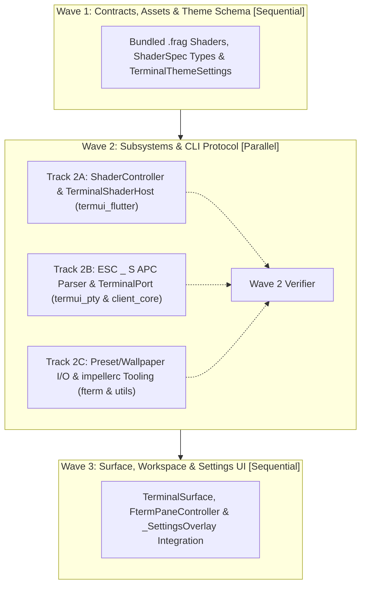

# Step 2: Custom FragmentShader Effects and CLI Shader Protocol (Issue #364)

Add user background images, `ui.FragmentShader` underlay and post-process effects (CRT, glow, scanlines), and a gated `ESC _ S` CLI protocol across `termui_flutter`, `termui_pty`, and `fterm`.

## User Review Required

> [!IMPORTANT]
> `ui.FragmentProgram.fromAsset` loads only `impellerc`-compiled `.iplr` bundles; `dart:ui` has no runtime GLSL compiler. `termui_flutter` therefore ships 5 AOT-compiled `.frag` shaders with JSON parameter presets (`~/.config/fterm/shaders/*.json`) and user wallpapers, plus `utils/compile_user_shader.dart` for Desktop `.frag` authors.

> [!WARNING]
> `ui.ImageFilter.shader` requires Impeller and throws `UnsupportedError` on Flutter Web (`isShaderFilterSupported == false`). Web runs background and blend-overlay shaders natively and marks pixel-sampling shaders as `ShaderBackendStatus.unsupportedOnWeb`, while PTY `ESC _ S` commands reject raw GLSL/SPIR-V and require `allowCliShaders: true`.

## Open Questions

1. Should `allowCliShaders` default to `false` globally (recommended for untrusted SSH and `termui_cast` sessions) or `true` for local shells? This plan defaults to `false` with a Settings toggle.
2. Should `termui_cast` relay servers forward `ESC _ S` events to remote viewers in v1, or keep `ESC _ S` local-pane-only initially? Wave 2 wires `TerminalPort` so relay framing can land independently.

## Existing System Context & Constraints

- Melos monorepo spanning `packages/termui_pty`, `packages/termui_flutter`, `apps/termui_cast/client_core`, `apps/fterm`, and `utils`.
- Targets Dart `>=3.11.0 <4.0.0` and Flutter `>=3.41.0` (Impeller on Desktop; CanvasKit/Skwasm on Web).
- `termui_flutter` owns `.frag` assets, `TerminalShaderConfig`, `TerminalShaderController`, leaf `TerminalShaderHost`, and `backgroundOpacity` alpha support in `TuiAtlasPainter`.
- `termui_pty` owns `ESC _ S ... ST` (`TerminalShaderApcEvent`) parsing in `shader_apc_handler.dart`, `VirtualTerminal` dispatch, and `TerminalPort` listener hooks.
- `termui_cast_client_core` owns `backgroundOpacity` and shader preset JSON persistence in `TerminalThemeSettings`, plus `RemoteTerminalPort` conformance.
- `fterm` owns async wallpaper/preset storage, per-pane CLI shader overrides in `FtermPaneController`, and Settings UI controls in `fterm_overlays.dart`.
- Animated `uTime` ticks must drive a leaf `ChangeNotifier` (`markNeedsPaint()` only) and pause when unfocused, hidden, or static (`usesTime == false`).
- Non-goals: rendering terminal glyph grids inside a fragment shader, or bundling the native `impellerc` binary inside end-user release installers.

## Target Architecture & Wave Topology

`TerminalShaderHost` wraps `TuiAtlasPainter` inside `TerminalSurface` with two optional GPU passes while keeping text on `Canvas.drawRawAtlas`.

The background pass paints a leaf `CustomPaint` behind `TuiAtlasPainter` with optional user or Kitty `ui.Image` (`uImage`) and scaled default `bg == 0` alpha (`backgroundOpacity`). The post-process pass uses `ImageFiltered(imageFilter: ui.ImageFilter.shader(shader))` on Impeller and falls back to foreground blend overlays or `unsupportedOnWeb` status on Web.



### Orchestration & Parallel Verification Matrix

| Wave / Track | Execution Mode | Orchestrator / Role | Workspace Isolation | Owned Files / Scope | Verification Gate |
| :--- | :--- | :--- | :--- | :--- | :--- |
| **Wave 1** | Sequential | Coordinator / Single Agent | Primary workspace | `packages/termui_flutter/shaders/*.frag`, `shader_spec.dart`, `terminal_theme_settings.dart` | `flutter test` in `termui_flutter` & `dart test` in `client_core` |
| **Track 2A** | Parallel (Wave 2) | `/swarm` author (`shader-host`) | `workspace: "share"` | `shader_controller.dart`, `shader_host.dart`, `shader_pipeline_test.dart` | `flutter test test/shader_pipeline_test.dart` |
| **Track 2B** | Parallel (Wave 2) | `/swarm` author (`shader-apc`) | `workspace: "share"` | `shader_apc_handler.dart`, `virtual_terminal.dart`, `terminal_port.dart`, `pty_router.dart`, `remote_terminal_port.dart` | `dart test test/shader_apc_test.dart` |
| **Track 2C** | Parallel (Wave 2) | `/swarm` author (`fterm-io`) | `workspace: "share"` | `settings_storage.dart`, `shader_profile_store*.dart`, `utils/compile_user_shader.dart` | `flutter test test/shader_profile_store_test.dart` |
| **Wave 2 Verifier** | Parallel Critic | `/swarm` `verifier` | `workspace: "inherit"` | Audits file disjointness, security bounds, and complexity `<= 15` | Cross-package `dart analyze --fatal-infos` |
| **Wave 3** | Sequential | Coordinator / Single Agent | Primary workspace | `painter.dart`, `terminal_surface.dart`, `fterm` controllers/UI, exports | Full `termui_flutter` & `fterm` test suites |

### Interface & Schema Specifications

```dart
// packages/termui_flutter/lib/src/rendering/shader_spec.dart
enum TerminalShaderStage { background, postProcess, overlayBlend }

enum ShaderBackendStatus { active, disabled, unsupportedOnWeb, loadError }

enum TerminalShaderPreset {
  none(assetKey: null, stage: TerminalShaderStage.background, usesTime: false, samplesChildTexture: false),
  wallpaperWave(assetKey: 'packages/termui_flutter/shaders/wallpaper_effect.frag', stage: TerminalShaderStage.background, usesTime: true, samplesChildTexture: false),
  cursorGlow(assetKey: 'packages/termui_flutter/shaders/cursor_glow.frag', stage: TerminalShaderStage.overlayBlend, usesTime: true, samplesChildTexture: false),
  scanlineOverlay(assetKey: 'packages/termui_flutter/shaders/scanline_overlay.frag', stage: TerminalShaderStage.overlayBlend, usesTime: false, samplesChildTexture: false),
  crtLottes(assetKey: 'packages/termui_flutter/shaders/crt_lottes.frag', stage: TerminalShaderStage.postProcess, usesTime: false, samplesChildTexture: true),
  phosphorGlow(assetKey: 'packages/termui_flutter/shaders/phosphor_glow.frag', stage: TerminalShaderStage.postProcess, usesTime: false, samplesChildTexture: true);

  final String? assetKey;
  final TerminalShaderStage stage;
  final bool usesTime;
  final bool samplesChildTexture;
  const TerminalShaderPreset({
    required this.assetKey,
    required this.stage,
    required this.usesTime,
    required this.samplesChildTexture,
  });
}

final class TerminalShaderConfig {
  final TerminalShaderPreset backgroundPreset;
  final String? customBackgroundAssetKey;
  final TerminalShaderPreset effectPreset;
  final String? customEffectAssetKey;
  final Float32List backgroundParams; // length 8 (uParams0, uParams1)
  final Float32List effectParams;     // length 8 (uParams0, uParams1)
  final BlendMode overlayBlendMode;
  final bool animate;
}
```

#### CLI `ESC _ S ... ST` APC Wire Grammar (Issue #364 Bonus)

`AnsiParser` already extracts `APC` payloads (`ESC _ ... BEL` or `ESC _ ... ESC \`). Payloads starting with `'S '` dispatch to `parseShaderApcPayload`:

| Action | Wire Example | Behavior & Bounds |
| :--- | :--- | :--- |
| `a=set` | `ESC _ S a=set,stage=post,preset=crt_lottes,p0=0.45,p1=0.2 ST` | Activates an allowlisted preset on `bg` or `post` and clamps `p0..p7` to `[0.0, 4.0]`. Optional `img=<uint32>` binds a Kitty image ID as `uImage`, and `opacity=<0.0..1.0>` sets `backgroundOpacity`. |
| `a=uniform` | `ESC _ S a=uniform,stage=post,p0=0.8,p2=0.1 ST` | Updates `p0..p7` scalar slots in place on the active CLI shader without reloading the `FragmentProgram`. Coalesced to vsync cadence. |
| `a=reset` | `ESC _ S a=reset,stage=all ST` | Clears CLI shader overrides for `bg`, `post`, or `all`. Triggered automatically on `RIS` (`ESC c`), `DECSTR` (`ESC [!p]`), and process exit. |

## Migration & Execution Phases

### Wave 1: Compatibility Shims & Shared Contracts [Sequential]

Author the 5 GLSL fragment shaders, register them in `packages/termui_flutter/pubspec.yaml`, and define immutable configuration schemas.

- [ ] [NEW] [wallpaper_effect.frag](packages/termui_flutter/shaders/wallpaper_effect.frag)
  - Implement cover/contain UV mapping for `sampler2D uImage`, dim/tint mixing against `uBackgroundColor`, vignette, and optional UV wave driven by `uTime`.
- [ ] [NEW] [crt_lottes.frag](packages/termui_flutter/shaders/crt_lottes.frag)
  - Declare `uniform vec2 uSize;` and `uniform sampler2D uTexture;` first per Impeller's `ImageFilter.shader` contract.
  - Implement barrel curvature, scanline cosine mask, shadow-mask triad, and corner vignette controlled by `uParams0` and `uParams1`.
- [ ] [NEW] [phosphor_glow.frag](packages/termui_flutter/shaders/phosphor_glow.frag)
  - Declare `uSize` and `uTexture` first, then compute a 9-tap tent bloom above luminance threshold `uParams0.x`, blended additively over crisp glyph pixels from the source.
- [ ] [NEW] [scanline_overlay.frag](packages/termui_flutter/shaders/scanline_overlay.frag)
  - Implement a sampler-free scanline, aperture-grille, and vignette shader compatible with Desktop and foreground overlays on Flutter Web.
- [ ] [NEW] [cursor_glow.frag](packages/termui_flutter/shaders/cursor_glow.frag)
  - Implement a sampler-free radial spotlight and pulse centered on `vec4 uCursorRect` using `uForegroundColor` and `uTime`.
- [ ] [MODIFY] [pubspec.yaml](packages/termui_flutter/pubspec.yaml)
  - Register all 5 `shaders/*.frag` files under the `flutter: shaders:` section.
- [ ] [NEW] [shader_spec.dart](packages/termui_flutter/lib/src/rendering/shader_spec.dart)
  - Define `TerminalShaderStage`, `ShaderBackendStatus`, `TerminalShaderPreset`, and `TerminalShaderConfig` with JSON serialization and finite-float clamping.
- [ ] [MODIFY] [terminal_theme_settings.dart](apps/termui_cast/client_core/lib/src/terminal_theme_settings.dart)
  - Add `double backgroundOpacity` (`0.0 .. 1.0`, default `1.0`) and shader preset fields to `TerminalThemeSettings` with backward-compatible JSON defaults.

**Wave 1 Verification**: `cd packages/termui_flutter; flutter test test/export_test.dart; cd ../../apps/termui_cast/client_core; dart analyze --fatal-infos; dart test test/terminal_theme_compositor_test.dart`

______________________________________________________________________

### Wave 2: Core Subsystem Migration [Parallel]

Build the Flutter GPU shader host, `termui_pty` `ESC _ S` APC parser, and `fterm` persistence/tooling in parallel across disjoint files.

#### Track 2A: `TerminalShaderController` & Leaf `TerminalShaderHost`

- **Depends on**: Wave 1
- **Owns**: `packages/termui_flutter/lib/src/rendering/shader_controller.dart`, `packages/termui_flutter/lib/src/rendering/shader_host.dart`, `packages/termui_flutter/test/shader_pipeline_test.dart`
- **Must Not Touch**: `packages/termui_flutter/lib/src/rendering/painter.dart`, `packages/termui_flutter/lib/src/terminal_surface.dart`, `packages/termui_flutter/lib/termui_flutter.dart`

- [ ] [NEW] [shader_controller.dart](packages/termui_flutter/lib/src/rendering/shader_controller.dart)
  - Implement `TerminalShaderController extends ChangeNotifier` caching `ui.FragmentProgram`s, resolving uniform slots once on load, and disposing superseded wallpaper `ui.Image`s post-frame.
  - Resolve `ShaderBackendStatus` via `ui.ImageFilter.isShaderFilterSupported` with `@visibleForTesting bool? debugShaderFilterSupportedOverride`.
- [ ] [NEW] [shader_host.dart](packages/termui_flutter/lib/src/rendering/shader_host.dart)
  - Implement `TerminalShaderHost extends StatefulWidget` with a leaf `Ticker` active only while `usesTime && config.animate && TickerMode.of(context)`.
  - Route ticks through a leaf `_ShaderFrameNotifier` (`CustomPainter(repaint: ...)` and leaf `ImageFilterLayer`) so `TerminalSurface` and `TuiAtlasPainter` never rebuild on `uTime`.
- [ ] [NEW] [shader_pipeline_test.dart](packages/termui_flutter/test/shader_pipeline_test.dart)
  - Test asset loading for all 5 shaders, zero `Ticker` ticks on static presets, leaf-only repaints on `cursorGlow`, Web fallback status, and `ui.Image` disposal.

**Track 2A Verification**: `cd packages/termui_flutter; dart format --output=none --set-exit-if-changed lib/src/rendering/shader_controller.dart lib/src/rendering/shader_host.dart test/shader_pipeline_test.dart; flutter analyze --no-pub; flutter test test/shader_pipeline_test.dart`

#### Track 2B: CLI `ESC _ S ... ST` Shader APC Parser & `TerminalPort` Plumb

- **Depends on**: Wave 1
- **Owns**: `packages/termui_pty/lib/src/shader_apc_handler.dart`, `packages/termui_pty/lib/src/virtual_terminal.dart`, `packages/termui_pty/lib/src/terminal_port.dart`, `packages/termui_pty/lib/src/pty_router.dart`, `apps/termui_cast/client_core/lib/src/remote_terminal_port.dart`, `packages/termui_pty/test/shader_apc_test.dart`
- **Must Not Touch**: `packages/termui_pty/lib/termui_pty.dart`, `packages/termui_flutter/**`, `apps/fterm/**`

- [ ] [NEW] [shader_apc_handler.dart](packages/termui_pty/lib/src/shader_apc_handler.dart)
  - Define `sealed class TerminalShaderApcEvent` and `parseShaderApcPayload(String payload)` with preset allowlists, `[0.0, 4.0]` float clamping, and a `1024`-char cap.
- [ ] [MODIFY] [virtual_terminal.dart](packages/termui_pty/lib/src/virtual_terminal.dart)
  - Dispatch `'S '` APC payloads to `parseShaderApcPayload`, notify shader listeners, and emit `TerminalResetShaderEvent` on `RIS` (`ESC c`) and `DECSTR` (`ESC [!p`).
- [ ] [MODIFY] [terminal_port.dart](packages/termui_pty/lib/src/terminal_port.dart)
  - Add `addShaderListener(void Function(TerminalShaderApcEvent event) listener)` and `removeShaderListener(...)` to `TerminalPort`.
- [ ] [MODIFY] [pty_router.dart](packages/termui_pty/lib/src/pty_router.dart)
  - Forward `VirtualTerminal` shader APC events through `PtyRouter` local port handles.
- [ ] [MODIFY] [remote_terminal_port.dart](apps/termui_cast/client_core/lib/src/remote_terminal_port.dart)
  - Implement `addShaderListener` and `removeShaderListener` on `RemoteTerminalPort` so workspace panes treat local and remote ports uniformly.
- [ ] [NEW] [shader_apc_test.dart](packages/termui_pty/test/shader_apc_test.dart)
  - Test `ESC _ S` `a=set`, `a=uniform`, `a=reset`, `img=42` binding, tmux passthrough, `NaN`/oversized rejection, and `RIS`/`DECSTR` auto-reset.

**Track 2B Verification**: `cd packages/termui_pty; dart format --output=none --set-exit-if-changed .; dart analyze --fatal-infos; dart test test/shader_apc_test.dart test/bell_and_audio_apc_test.dart; cd ../../apps/termui_cast/client_core; dart analyze --fatal-infos; dart test test/remote_terminal_port_test.dart`

#### Track 2C: `fterm` Preferences, Wallpaper/Preset Store & `impellerc` Helper

- **Depends on**: Wave 1
- **Owns**: `apps/fterm/lib/src/settings_storage.dart`, `apps/fterm/lib/src/shader_profile_store.dart`, `apps/fterm/lib/src/shader_profile_store_io.dart`, `apps/fterm/lib/src/shader_profile_store_stub.dart`, `apps/fterm/lib/src/shader_profile_store_web.dart`, `utils/compile_user_shader.dart`, `apps/fterm/test/shader_profile_store_test.dart`
- **Must Not Touch**: `apps/fterm/lib/src/workspace/**`, `apps/fterm/lib/src/ui/**`, `packages/**`

- [ ] [MODIFY] [settings_storage.dart](apps/fterm/lib/src/settings_storage.dart)
  - Add `bool allowCliShaders` (default `false`), `String? backgroundImagePath`, and `String? customShaderProfileJson` to `FtermPreferences` with resilient JSON serialization.
- [ ] [NEW] [shader_profile_store.dart](apps/fterm/lib/src/shader_profile_store.dart)
  - Define async platform interface loading validated wallpaper bytes (`<= 16 MiB` PNG/JPEG/WebP) and JSON shader preset profiles without synchronous I/O.
- [ ] [NEW] [shader_profile_store_stub.dart](apps/fterm/lib/src/shader_profile_store_stub.dart)
  - Provide pure-Dart in-memory stub implementation for headless widget tests.
- [ ] [NEW] [shader_profile_store_io.dart](apps/fterm/lib/src/shader_profile_store_io.dart)
  - Implement async `File.readAsBytes()` wallpaper and `~/.config/fterm/shaders/` JSON preset discovery on macOS, Linux, and Windows.
- [ ] [NEW] [shader_profile_store_web.dart](apps/fterm/lib/src/shader_profile_store_web.dart)
  - Implement bounded IndexedDB / `localStorage` wallpaper and JSON preset persistence on Web.
- [ ] [NEW] [compile_user_shader.dart](utils/compile_user_shader.dart)
  - Provide a standalone Dart CLI locating `<flutter-sdk>/bin/cache/artifacts/engine/.../impellerc` to compile user `.frag` files into `.iplr` runtime-stage bundles.
- [ ] [NEW] [shader_profile_store_test.dart](apps/fterm/test/shader_profile_store_test.dart)
  - Test `FtermPreferences` `allowCliShaders` round-trip, async validation of image headers, oversized (`> 16 MiB`) rejection, and malformed JSON fallback.

**Track 2C Verification**: `cd apps/fterm; dart format --output=none --set-exit-if-changed lib/src/settings_storage.dart lib/src/shader_profile_store*.dart test/shader_profile_store_test.dart; flutter analyze --no-pub; flutter test test/shader_profile_store_test.dart test/desktop_launch_and_storage_test.dart`

**Wave 2 Verifier & Barrier Gate**:
- Peer `verifier` audits Tracks 2A, 2B, and 2C for zero file collisions, async-only I/O, `ESC _ S` sanitization, and cognitive complexity `<= 15`.
- Wave barrier command: `cd packages/termui_pty; dart test; cd ../termui_flutter; flutter test; cd ../../apps/fterm; flutter test`

______________________________________________________________________

### Wave 3: Cutover, Chokepoint Wiring & Cleanup [Sequential]

Connect `TerminalShaderHost`, `backgroundOpacity`, `ESC _ S` pane overrides, and Settings UI across `termui_flutter` and `fterm`.

- [ ] [MODIFY] [painter.dart](packages/termui_flutter/lib/src/rendering/painter.dart)
  - Respect partial alpha on `defaultBackgroundArgb` so default `bg == 0` cells reveal `TerminalShaderStage.background` while explicit `bg != 0` cells paint opaque.
- [ ] [MODIFY] [terminal_surface.dart](packages/termui_flutter/lib/src/terminal_surface.dart)
  - Add `TerminalShaderController? shaderController`, `TerminalShaderConfig? shaderConfig`, and `double backgroundOpacity = 1.0` to `TerminalSurface`.
  - Wrap `_buildCanvasContainer` with `TerminalShaderHost`, forwarding cursor pixel rects and Kitty `uImage` textures when CLI shaders set `img=<kittyId>`.
- [ ] [MODIFY] [termui_flutter.dart](packages/termui_flutter/lib/termui_flutter.dart)
  - Export `TerminalShaderStage`, `ShaderBackendStatus`, `TerminalShaderPreset`, `TerminalShaderConfig`, `TerminalShaderController`, and `TerminalShaderHost`.
- [ ] [MODIFY] [termui_pty.dart](packages/termui_pty/lib/termui_pty.dart)
  - Export `src/shader_apc_handler.dart`.
- [ ] [MODIFY] [pubspec.yaml](apps/fterm/pubspec.yaml)
  - Declare `packages/termui_flutter/shaders/*.frag` under `flutter: shaders:` so `fterm` Desktop and Web builds bundle the compiled programs.
- [ ] [MODIFY] [fterm_pane_controller.dart](apps/fterm/lib/src/workspace/fterm_pane_controller.dart)
  - Subscribe to `port.addShaderListener`, apply per-pane CLI overrides only when `allowCliShaders` is `true`, and clear on pane exit or toggle-off.
- [ ] [MODIFY] [fterm_workspace_controller.dart](apps/fterm/lib/src/workspace/fterm_workspace_controller.dart)
  - Expose shader preset and uniform mutators, `backgroundOpacity` updates, async actions for loading wallpapers, and `setAllowCliShaders(bool)`.
- [ ] [MODIFY] [fterm_shell_scaffold.dart](apps/fterm/lib/src/ui/fterm_shell_scaffold.dart)
  - Pass effective per-pane `shaderConfig` (CLI override over workspace config) and `backgroundOpacity` into each pane's `TerminalSurface`.
- [ ] [MODIFY] [fterm_overlays.dart](apps/fterm/lib/src/ui/fterm_overlays.dart)
  - Add **Shaders & Background** controls in `_SettingsOverlay` (preset dropdowns, opacity/uniform sliders, wallpaper picker, `Allow CLI Shaders` toggle, and Web status notice).
- [ ] [NEW] [fterm_shader_settings_widget_test.dart](apps/fterm/test/fterm_shader_settings_widget_test.dart)
  - Test preset switching, `backgroundOpacity` persistence, `allowCliShaders` gating of `ESC _ S`, pane-exit reset, and Web `unsupportedOnWeb` notice rendering.

**Wave 3 Verification**: `cd packages/termui_flutter; dart format --output=none --set-exit-if-changed .; flutter analyze --no-pub; flutter test; cd ../../apps/fterm; dart format --output=none --set-exit-if-changed .; flutter analyze --no-pub; flutter test`

______________________________________________________________________

## Verification Plan

### Automated Regression & Integration Tests

- PTY `ESC _ S` APC unit suite: `cd packages/termui_pty; dart test test/shader_apc_test.dart`
- Flutter shader pipeline & golden suite: `cd packages/termui_flutter; flutter test`
- `fterm` settings, storage, and widget suite: `cd apps/fterm; flutter test`
- Monorepo format & static analysis gate: `dart format --output=none --set-exit-if-changed .; dart analyze --fatal-infos`

### Edge Cases & Failure Scenarios

1. Selecting `crtLottes` or `scanlineOverlay` (`usesTime: false`) must keep `SchedulerBinding.instance.transientCallbackCount == 0` while idle.
2. Animated shaders (`wallpaperWave`, `cursorGlow`) must stop their `Ticker` when an overlay modal obscures the workspace or `AppLifecycleState` leaves `resumed`.
3. Selecting `crtLottes` on Flutter Web must never throw `UnsupportedError`; `TerminalShaderHost` renders the child directly and reports `ShaderBackendStatus.unsupportedOnWeb`.
4. Streaming 10,000 malformed or `NaN` `ESC _ S` sequences in one PTY chunk must allocate zero `FragmentProgram`s and reset cleanly on `ESC c` (`RIS`).
5. Pressing `F12` (`TerminalSurfaceState.takeScreenshot`) must capture both the background wallpaper/shader and post-process shader inside the `RepaintBoundary`.

### Performance & Complexity Audit

- Verify via `Tracer` on a 4K 120 Hz desktop pane that `uTime` ticks on `cursorGlow` trigger `0` widget rebuilds and `0` `TuiAtlasPainter.paint` calls.
- Verify all new methods in `shader_controller.dart`, `shader_host.dart`, and `shader_apc_handler.dart` score `<= 15` on cognitive complexity.

## Rollback & Disaster Recovery Plan

1. Rollback trigger: Impeller driver crash on a desktop GPU backend or frame-time regression exceeding `1.0 ms` when `TerminalShaderPreset.none` is selected.
2. Rollback steps: when `backgroundPreset == .none && effectPreset == .none && backgroundImage == null`, `TerminalShaderHost` returns the bare child widget with zero wrapper layers.
