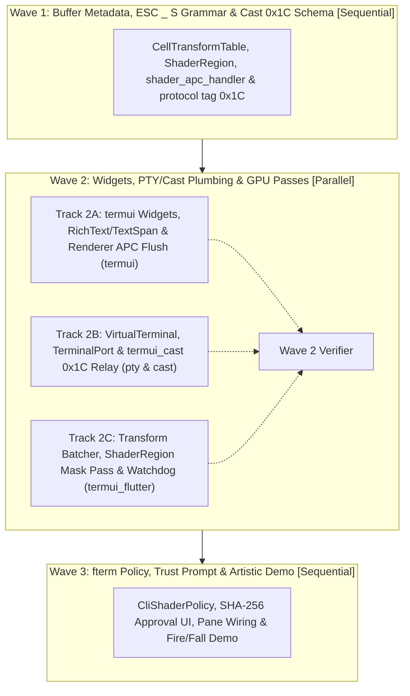

# Step 3: CLI Artistic Shaders, Scoped Regions & Per-Cell Transforms

Enable `termui` CLI apps and PTY games speaking `ESC _ S` to attach scoped region shaders ("this word is on fire"). Add per-cell transforms ("letters fall, rotate, scale, and overlap") with 120 Hz host kinematics, streamed over capability-negotiated `termui_cast` `0x1C` frames under a strict GPU trust policy.

## User Review Required

> [!IMPORTANT]
> Scoped CLI effects use region-based `ShaderRegion` entries (`List<Rect> sourceRects`, `CellPadding`, and blend stage) instead of a full-grid per-cell shader array. Only glyphs inside `sourceRects` draw into `uGlyphMask`, while expanding the draw quad by `padding` lets flames rise over adjacent rows without affecting neighboring text. Per-cell transforms use a lazy sparse `CellTransformTable` mapped onto `Canvas.drawRawAtlas` (`RSTransform`) and batched `Canvas.drawVertices`, plus optional 120 Hz host kinematics. In v1, `CellTransform` is visual-only (pointer hit-testing, selection, and link hover remain logical-grid-anchored; inverse-mapped hit-testing on transformed glyphs is deferred to a follow-up enhancement).

> [!WARNING]
> Untrusted PTY streams can abuse custom GLSL to hang host GPUs (TDR) or spoof UI. `FtermPreferences` therefore uses a 4-level `CliShaderPolicy`. Local panes default to `promptCustomGlsl` (presets and bounded transforms enabled; SHA-256 prompt once per custom GLSL hash, max `4` pending prompts per pane with "Deny All"), while remote `termui_cast` panes default to `disabled`. Every CLI shader is capped at `<= 32 KiB` source (`<= 64 KiB` local user shaders in Step 2), `<= 16` slots per pane, restricted includes, a `4s` CLI compile timeout, and a best-effort GPU watchdog.

## Open Questions

> [!NOTE]
> All Step 3 decisions are resolved in [open_questions.md](open_questions.md).

## Existing System Context & Constraints

- Depends on [step1_optimized_draw_raw_atlas_plan.md](step1_optimized_draw_raw_atlas_plan.md) (`TuiAtlasStagingCache` `cellOverrideMask` across all paint passes) and [step2_fragment_shader_effects_issue_364_plan.md](step2_fragment_shader_effects_issue_364_plan.md) (`TerminalShaderBackend` with `prevFrameKey`, `iRegionRect`, `iCellSize`, and single-flight async staging).
- `packages/termui` (Dart `>=3.11.0`) owns lazy `CellTransformTable` and `ShaderRegion` metadata on `Buffer`, `ShaderRegionWidget`, `CellTransformWidget`, inline `RichText`/`TextSpan` hooks, and capability-aware `Renderer` `\x1b_S` diff flushing.
- `packages/termui_pty` (Dart `>=3.11.0`) owns `shader_apc_handler.dart` (`\x1b_S` APC grammar matching `\x1b_G` and `\x1b_A` without a mandatory space), `VirtualTerminal` per-screen (`_primaryBuffer` vs `_altBuffer`) lifecycle dispatch and `a=query` replies, `TerminalPort`, and `PtyRouter`.
- `apps/termui_cast/*` owns the capability-negotiated binary tag `0x1C` (`_tagShader`) in `buffer_frame_codec.dart`, caster capture and keyframe replay in `AuthoritativeTerminal`, synchronized fan-out (`_fanOutSynchronizedFrame`, like `0x1B`) and explicit rate caps in `SessionRegistry` / `WsRelayHandler`, and remote decode in `CastClientRepository` / `RemoteTerminalPort`.
- `packages/termui_flutter` owns the animated transform pass (`drawRawAtlas` + `drawVertices` + 120 Hz kinematics), the tight-bbox `ShaderRegion` `uGlyphMask` pass, and the best-effort `GpuFrameWatchdog`.
- `apps/fterm` owns `CliShaderPolicy`, per-pane CLI shader/transform state, metadata propagation in `FtermPaneController._tryIncrementalRecomposite`, SHA-256 trust prompts, and Settings UI controls.
- Plain terminal and degraded-GPU fallback: standard emulators (`xterm`, `tmux`, `iTerm2`) ignore unknown APC sequences, and `fterm` under `ShaderBackendKind.disabled` replies `glsl=0,backend=disabled` on `a=query`.
- All functions must stay at or below SonarSource cognitive complexity `15` with zero `dynamic` tokens.

## Target Architecture & Wave Topology

Step 3 connects four layers cleanly. One `termui` widget tree runs embedded inside `termui_flutter` via direct `Buffer` reads. Over a PTY or `termui_cast` relay, the same tree flows through `\x1b_S` APC -> `VirtualTerminal` -> negotiated `0x1C` frame -> `TerminalSurface`.



### Orchestration & Parallel Verification Matrix

| Wave / Track | Execution Mode | Orchestrator / Role | Workspace Isolation | Owned Files / Scope | Verification Gate |
| :--- | :--- | :--- | :--- | :--- | :--- |
| **Wave 1** | Sequential | Coordinator / Single Agent | Primary workspace | `cell_transform.dart`, `shader_region.dart`, `buffer.dart`, `shader_apc_encoder.dart`, `shader_apc_handler.dart`, `buffer_frame_codec.dart`, `messages.dart` | `dart test` in `termui`, `termui_pty`, `termui_cast/protocol` |
| **Track 2A** | Parallel (Wave 2) | `/swarm` author (`termui-widgets`) | `workspace: "share"` | `shader_region_widget.dart`, `cell_transform_widget.dart`, `rich_text.dart`, `renderer.dart`, `widget_toolkit.dart`, `packages/termui/test/**` | `dart test` in `packages/termui` |
| **Track 2B** | Parallel (Wave 2) | `/swarm` author (`pty-and-cast`) | `workspace: "share"` | `virtual_terminal.dart`, `terminal_port.dart`, `pty_router.dart`, `authoritative_terminal.dart`, `caster_service.dart`, `session_registry.dart`, `ws_relay_handler.dart`, `cast_client_repository.dart`, `remote_terminal_port.dart` | `dart test` in `termui_pty`, `caster_cli`, `server`, `client_core` |
| **Track 2C** | Parallel (Wave 2) | `/swarm` author (`flutter-painter`) | `workspace: "share"` | `cell_transform_painter.dart`, `shader_region_painter.dart`, `gpu_frame_watchdog.dart`, `painter.dart`, `terminal_surface.dart` | `flutter test` in `packages/termui_flutter` |
| **Wave 2 Verifier** | Parallel Critic | `/swarm` `verifier` | `workspace: "inherit"` | Audits file disjointness, fuzz/bounds safety, zero `dynamic`, complexity `<= 15` | Cross-package `dart analyze --fatal-infos` |
| **Wave 3** | Sequential | Coordinator / Single Agent | Primary workspace | `fterm` `CliShaderPolicy`, SHA-256 prompt overlay, pane controller, shared example demo | Full workspace `dart test` & `flutter test` |

### Interface & Schema Specifications

```dart
// packages/termui/lib/ui/cell_transform.dart
final class CellKinematics {
  final int animationId;      // Stable logical ID so unrelated rebuilds never restart motion
  final double vx;            // Cells per second
  final double vy;
  final double ax;            // Gravity / acceleration in cells/sec^2
  final double ay;
  final double vRot;          // Radians per second
  final double scaleRateX;
  final double scaleRateY;
  final double alphaRate;
  final double durationSec;   // <= 0 means open-ended until cleared/clamped
}

final class CellTransform {
  final double dx;            // Fractional cell offset
  final double dy;
  final double scaleX;
  final double scaleY;
  final double rotationRad;
  final double alpha;         // 0.0..1.0
  final int zLayer;           // 0 = base grid, >0 floats above static UI
  final CellKinematics? kinematics;
}

/// Lazy sparse table attached to Buffer (zero allocation when unused).
final class CellTransformTable {
  bool get isEmpty;
  Iterable<MapEntry<int, CellTransform>> get entries;
  void set(int cellIndex, CellTransform transform);
  void remove(int cellIndex);
  void shiftRows(int deltaRows, int cols, int rows);
  void clear();
}

// packages/termui/lib/ui/shader_region.dart
enum ShaderRegionStage { underGlyphs, replaceGlyphs, overGlyphs }

final class CellPadding {
  final int top;
  final int right;
  final int bottom;
  final int left;
  const CellPadding({this.top = 0, this.right = 0, this.bottom = 0, this.left = 0});
}

final class ShaderRegion {
  final String id;
  final String shaderId;        // Built-in preset (e.g. 'fire') or CLI-defined GLSL id
  final List<Rect> sourceRects; // Only glyphs inside these rects render into uGlyphMask
  final CellPadding padding;    // Output quad bleed in cells (e.g. top: 2 for flames)
  final ShaderRegionStage stage;
  final int zIndex;
  final bool persist;           // Keyed via prevFrameKey: 'region:$id'
  final Float32List params;     // 8 user floats (uParams0, uParams1)
}

// apps/fterm/lib/src/settings_storage.dart
enum CliShaderPolicy {
  disabled,
  presetsAndTransforms,
  promptCustomGlsl,
  allowLocalCustomGlsl,
}
```

#### CLI `ESC _ S ... ST` APC Wire Grammar

Matches `\x1b_G` (Kitty graphics) and `\x1b_A` (audio) without a mandatory space (`\x1b_S<k=v,...>[;<base64>]\x1b\\`). Semicolon `;` is reserved strictly for base64 payload separation.

| Action | Wire Example | Behavior & Bounds |
| :--- | :--- | :--- |
| `a=query` | `\x1b_Sa=query\x1b\\` | Host replies `\x1b_Sa=caps,backend=flutter_gpu\|webgl2\|disabled,glsl=1\|0,xform=1,region=1\|0,max_slots=16\x1b\\`. |
| `a=define` | `\x1b_Sa=define,id=fire,m=1;<base64 glsl>\x1b\\` | Uploads chunked Ghostty Shadertoy GLSL (`<= 32 KiB` total, `<= 16` live slots/pane). Accepts `iChannel0` as `uGlyphMask` in region passes and optional `persist=1`. |
| `a=region` | `\x1b_Sa=region,id=r1,s=fire,rects=10:4:4:1/0:5:6:1,pad=2:1:0:1,stage=over,p0=1.2\x1b\\` | Attaches or updates a scoped `ShaderRegion` (`rects` uses `/` between `x:y:w:h` spans; `pad=top:right:bottom:left` clamped to `0..8` cells). |
| `a=xform` | `\x1b_Sa=xform,c=10,r=4,aid=7,dx=0,dy=0,rot=0.1,sx=1.2,sy=1.2,vy=2,ay=18,vr=3.1\x1b\\` | Sets one cell's `CellTransform` and optional host-side `CellKinematics` keyed by `aid`. Untrusted local panes clamp `\|dx\|, \|dy\| <= 4` cells and `scale` to `[0.1, 4.0]`. |
| `a=xforms` | `\x1b_Sa=xforms;<base64 packed structs>\x1b\\` | Updates up to `1,024` transforms in one binary frame. Little-endian fixed `48`-byte stride: `u16 col`, `u16 row`, `u8 flags` (`bit0=hasKinematics`), `i8 zLayer`, `u16 animId`, `f32 dx`, `f32 dy`, `f32 sx`, `f32 sy`, `f32 rot`, `f32 alpha`, `f32 vx`, `f32 vy`, `f32 ay`, `f32 vRot`. |
| `a=set` / `a=uniform` | `\x1b_Sa=set,stage=post,preset=crt_lottes,p0=0.4\x1b\\` | Activates a full-pane preset/custom shader or updates `p0..p7` (clamped `[-16.0, 16.0]`) without recompiling. |
| `a=reset` | `\x1b_Sa=reset,target=all\|regions\|xforms\|pane\x1b\\` | Clears CLI overrides. Triggered automatically on `RIS` (`ESC c`), `DECSTR` (`ESC [!p`), alt-screen exit (`?47`/`?1047`/`?1049`), and process exit. |

## Migration & Execution Phases

### Wave 1: Buffer Metadata, `ESC _ S` Grammar & Cast `0x1C` Schema [Sequential]

Define zero-overhead `Buffer` side tables, pure-Dart APC encode/decode layers, and capability-negotiated `termui_cast_protocol` binary tag `0x1C`.

- [ ] [NEW] [cell_transform.dart](../../packages/termui/lib/ui/cell_transform.dart)
  - Implement `CellKinematics` (with logical `animationId`), `CellTransform`, and sparse `CellTransformTable` with finite-float clamping and `shiftRows` support.
- [ ] [NEW] [shader_region.dart](../../packages/termui/lib/ui/shader_region.dart)
  - Implement `ShaderRegionStage`, `CellPadding`, `ShaderRef` (preset or inline GLSL), and `ShaderRegion` (with `persist`).
- [ ] [MODIFY] [buffer.dart](../../packages/termui/lib/ui/buffer.dart)
  - Add lazy `CellTransformTable? _cellTransforms`, `List<ShaderRegion> shaderRegions`, `setCellTransform`, `addShaderRegion`, and propagate both with clip/offset translation inside `propagateMetadataFrom` and `clear()`.
- [ ] [NEW] [shader_apc_encoder.dart](../../packages/termui/lib/terminal/shader_apc_encoder.dart)
  - Encode `a=query`, chunked `a=define`, `a=region` (`/`-delimited `rects`), `a=xform`, little-endian `48`-byte `a=xforms`, `a=uniform`, and `a=reset` into `\x1b_S...` sequences.
- [ ] [MODIFY] [termui.dart](../../packages/termui/lib/termui.dart)
  - Export `cell_transform.dart`, `shader_region.dart`, and `shader_apc_encoder.dart`.
- [ ] [NEW] [shader_apc_handler.dart](../../packages/termui_pty/lib/src/shader_apc_handler.dart)
  - Implement `sealed class TerminalShaderApcEvent` and stateful chunk assembler `ShaderApcParser` enforcing `<= 32 KiB` CLI GLSL limit, `<= 16` live slots, `<= 1,024` transforms per batch, `/` `rects` splitting, `48`-byte `a=xforms` unpacking, and `NaN`/infinity rejection.
- [ ] [MODIFY] [buffer_frame_codec.dart](../../apps/termui_cast/protocol/lib/src/buffer_frame_codec.dart) & [messages.dart](../../apps/termui_cast/protocol/lib/src/messages.dart)
  - Add a `shaderFrames` capability bit to `AuthAcceptedFrame` and `SubscribeSessionFrame` so older relays and viewers never receive unknown `0x1C` frames.
  - Add binary frame tag `_tagShader = 0x1C` (`ShaderFrame` / `CastShaderPayload`) carrying typed shader definitions, regions, cell transform batches, uniforms, and resets with strict byte caps (`<= 64 KiB`).
- [ ] [NEW] Unit tests: `packages/termui/test/cell_transform_and_shader_region_test.dart`, `packages/termui_pty/test/shader_apc_test.dart`, `apps/termui_cast/protocol/test/shader_frame_codec_test.dart`.

**Wave 1 Verification**: `cd packages/termui; dart test test/cell_transform_and_shader_region_test.dart; cd ../termui_pty; dart test test/shader_apc_test.dart; cd ../../apps/termui_cast/protocol; dart test test/shader_frame_codec_test.dart`

______________________________________________________________________

### Wave 2: Widgets, PTY/Cast Plumbing & GPU Passes [Parallel]

Build declarative `termui` authoring APIs, end-to-end PTY + synchronized `termui_cast` forwarding, and the Flutter GPU/WebGL2 painter passes concurrently.

#### Track 2A: `termui` Widgets, `RichText`/`TextSpan` & `Renderer` APC Flush

- **Depends on**: Wave 1
- **Owns**: `packages/termui/lib/ui/widgets/display/shader_region_widget.dart`, `packages/termui/lib/ui/widgets/display/cell_transform_widget.dart`, `packages/termui/lib/ui/widgets/display/rich_text.dart`, `packages/termui/lib/ui/renderer.dart`, `packages/termui/lib/ui/widget_toolkit.dart`, `packages/termui/lib/terminal/event.dart`, `packages/termui/lib/terminal/input_parser.dart`, `packages/termui/test/shader_widgets_and_renderer_test.dart`
- **Must Not Touch**: `packages/termui_pty/**`, `packages/termui_flutter/**`, `apps/**`

- [ ] [NEW] [shader_region_widget.dart](../../packages/termui/lib/ui/widgets/display/shader_region_widget.dart)
  - Implement `ShaderRegionWidget` (parallel to `EffectWidget`) registering its child's painted `Rect` + `CellPadding` + `ShaderRef` onto `Buffer.shaderRegions`.
- [ ] [NEW] [cell_transform_widget.dart](../../packages/termui/lib/ui/widgets/display/cell_transform_widget.dart)
  - Implement `CellTransformWidget` and `KineticText` applying static transforms or gravity/scatter kinematics with stable logical `animationId` values so unrelated rebuilds never restart motion.
- [ ] [MODIFY] [rich_text.dart](../../packages/termui/lib/ui/widgets/display/rich_text.dart)
  - Add optional `ShaderRef? shader`, `CellPadding shaderPadding`, `ShaderRegionStage shaderStage`, and `CellTransform? transform` on `TextSpan`.
  - During wrapped line layout, collect exact per-line `Rect` spans for any shader-tagged `TextSpan` into `ShaderRegion.sourceRects` so wrapped phrases like `"this word is on fire"` emit one unified region.
- [ ] [MODIFY] [event.dart](../../packages/termui/lib/terminal/event.dart) & [input_parser.dart](../../packages/termui/lib/terminal/input_parser.dart)
  - Decode inbound `\x1b_Sa=caps,...\x1b\\` replies into `ShaderCapabilitiesEvent` (including negative `glsl=0,backend=disabled` reports).
- [ ] [MODIFY] [renderer.dart](../../packages/termui/lib/ui/renderer.dart)
  - Diff `Buffer.shaderRegions` and `Buffer.cellTransforms` (keyed by logical `animationId`) between front and back buffers, uploading custom GLSL once by hash.
  - Emit minimal `\x1b_S` APC updates when capabilities are active, and skip APC emission on plain terminals or `glsl=0` hosts.
- [ ] [MODIFY] [widget_toolkit.dart](../../packages/termui/lib/ui/widget_toolkit.dart)
  - Export `shader_region_widget.dart` and `cell_transform_widget.dart`.
- [ ] [NEW] [shader_widgets_and_renderer_test.dart](../../packages/termui/test/shader_widgets_and_renderer_test.dart)
  - Test wrapped `TextSpan` multi-rect `ShaderRegion` generation, `KineticText` stable `animationId` diffing, `Renderer` diff emission, deduplicated GLSL uploads, and plain-terminal / `glsl=0` no-op fallback.

**Track 2A Verification**: `cd packages/termui; dart format --output=none --set-exit-if-changed .; dart analyze --fatal-infos; dart test`

#### Track 2B: PTY Dispatch, `TerminalPort` & Synchronized `termui_cast` `0x1C` Forwarding

- **Depends on**: Wave 1
- **Owns**: `packages/termui_pty/lib/src/virtual_terminal.dart`, `packages/termui_pty/lib/src/terminal_port.dart`, `packages/termui_pty/lib/src/pty_router.dart`, `packages/termui_pty/lib/termui_pty.dart`, `apps/termui_cast/caster_cli/lib/src/authoritative_terminal.dart`, `apps/termui_cast/caster_cli/lib/src/caster_service.dart`, `apps/termui_cast/server/lib/src/session_registry.dart`, `apps/termui_cast/server/lib/src/ws_relay_handler.dart`, `apps/termui_cast/client_core/lib/src/cast_client_repository.dart`, `apps/termui_cast/client_core/lib/src/remote_terminal_port.dart`, related tests
- **Must Not Touch**: `packages/termui/**`, `packages/termui_flutter/**`, `apps/fterm/**`

- [ ] [MODIFY] [virtual_terminal.dart](../../packages/termui_pty/lib/src/virtual_terminal.dart)
  - Dispatch `'S'` APC payloads to `ShaderApcParser` and reply to `a=query` via `onReply`.
  - Scope `shaderRegions` and `cellTransforms` per screen buffer (`_primaryBuffer` vs `_altBuffer`, clearing `_altBuffer` on `?47`/`?1047`/`?1049` exit), shift or evict coordinates on scroll and resize, hide during `_viewportOffset != 0` scrollback, and emit `TerminalResetShaderEvent` on `RIS` (`ESC c`) and `DECSTR` (`ESC [!p`).
- [ ] [MODIFY] [terminal_port.dart](../../packages/termui_pty/lib/src/terminal_port.dart), [pty_router.dart](../../packages/termui_pty/lib/src/pty_router.dart), & [termui_pty.dart](../../packages/termui_pty/lib/termui_pty.dart)
  - Add `addShaderListener` / `removeShaderListener` on `TerminalPort`, forward through `PtyRouter`, and export `shader_apc_handler.dart`.
- [ ] [MODIFY] [authoritative_terminal.dart](../../apps/termui_cast/caster_cli/lib/src/authoritative_terminal.dart) & [caster_service.dart](../../apps/termui_cast/caster_cli/lib/src/caster_service.dart)
  - Emit `0x1C` `ShaderFrame`s only when `AuthAcceptedFrame` advertises `shaderFrames`, and replay active shader definitions, regions, and transforms whenever `RequestKeyframeFrame` fires.
- [ ] [MODIFY] [session_registry.dart](../../apps/termui_cast/server/lib/src/session_registry.dart) & [ws_relay_handler.dart](../../apps/termui_cast/server/lib/src/ws_relay_handler.dart)
  - Advertise `shaderFrames` in `AuthAcceptedFrame`, inspect `0x1C` frames, enforce explicit per-session budgets (`<= 120` frames/sec and `<= 512 KiB`/sec), and relay via `_fanOutSynchronizedFrame` (like `0x1B`, never droppable `0x19` audio) strictly to opted-in subscribers.
- [ ] [MODIFY] [cast_client_repository.dart](../../apps/termui_cast/client_core/lib/src/cast_client_repository.dart) & [remote_terminal_port.dart](../../apps/termui_cast/client_core/lib/src/remote_terminal_port.dart)
  - Opt into `shaderFrames` on `SubscribeSessionFrame`, decode `0x1C` `ShaderFrame`s, and dispatch through `RemoteTerminalPort.addShaderListener`.
- [ ] [NEW] Tests in `packages/termui_pty/test/virtual_terminal_shader_test.dart` and `apps/termui_cast/client_core/test/remote_shader_forwarding_test.dart`.

**Track 2B Verification**: `cd packages/termui_pty; dart analyze --fatal-infos; dart test; cd ../../apps/termui_cast/caster_cli; dart test; cd ../server; dart test; cd ../client_core; dart test`

#### Track 2C: Animated Transform Painter, `ShaderRegion` Mask Pass & GPU Watchdog

- **Depends on**: Wave 1 and Step 2 `TerminalShaderBackend`
- **Owns**: `packages/termui_flutter/lib/src/rendering/cell_transform_painter.dart`, `packages/termui_flutter/lib/src/rendering/shader_region_painter.dart`, `packages/termui_flutter/lib/src/rendering/gpu_frame_watchdog.dart`, `packages/termui_flutter/lib/src/rendering/painter.dart`, `packages/termui_flutter/lib/src/terminal_surface.dart`, `packages/termui_flutter/lib/termui_flutter.dart`, `packages/termui_flutter/test/cell_transform_and_region_painter_test.dart`
- **Must Not Touch**: `packages/termui/**`, `packages/termui_pty/**`, `apps/**`

- [ ] [NEW] [cell_transform_painter.dart](../../packages/termui_flutter/lib/src/rendering/cell_transform_painter.dart)
  - Evaluate active `CellTransform` and `CellKinematics` by logical `animationId` start time (120 Hz ticker active only while kinematics run).
  - Mark active cells in Step 1's `cellOverrideMask` across text, emoji, italic, fallback, ligature, and decoration passes so no duplicate static glyphs appear.
  - Batch uniform-scale atlas glyphs (`scaleX == scaleY`) into `Canvas.drawRawAtlas` (`RSTransform`: `[scale*cos(r), scale*sin(r), tx, ty]` around cell center), non-uniform atlas glyphs into batched `Canvas.drawVertices`, and transformed fallback glyphs via `Canvas.save`/`transform`/`restore`, sorted by `zLayer`.
- [ ] [NEW] [shader_region_painter.dart](../../packages/termui_flutter/lib/src/rendering/shader_region_painter.dart)
  - Ship built-in region presets (`fire`, `ice_frost`, `neon_pulse`, `glitch_tear`) in Ghostty Shadertoy GLSL.
  - Compute the tight union bounding box of `sourceRects` (expanded for transformed glyphs) plus `padding`, rasterize only those glyphs into `uGlyphMask`, and submit single-flight async passes via Step 2's `TerminalShaderBackend.renderPassesAsync` using `prevFrameKey: 'region:${region.id}'`, `iRegionRect`, and `iCellSize`.
  - Composite at `underGlyphs`, `replaceGlyphs` (via `cellOverrideMask`), or `overGlyphs`.
- [ ] [NEW] [gpu_frame_watchdog.dart](../../packages/termui_flutter/lib/src/rendering/gpu_frame_watchdog.dart)
  - Implement best-effort GPU watchdog: use `EXT_disjoint_timer_query_webgl2` on Web and `CommandBuffer.submit(completionCallback: ...)` paired with `FrameTiming.rasterDuration` on Desktop; trip on sustained `> 33 ms` frames, a single completion-timeout miss, or `webglcontextlost`, disabling custom CLI shaders for that pane and notifying `fterm`.
- [ ] [MODIFY] [painter.dart](../../packages/termui_flutter/lib/src/rendering/painter.dart) & [terminal_surface.dart](../../packages/termui_flutter/lib/src/terminal_surface.dart)
  - Wire `cellOverrideMask`, `CellTransformPainter`, `ShaderRegionPainter`, `GpuFrameWatchdog`, and the on-demand kinematics `Ticker`.
- [ ] [MODIFY] [termui_flutter.dart](../../packages/termui_flutter/lib/termui_flutter.dart)
  - Export `GpuFrameWatchdog` and presets for region shaders.
- [ ] [NEW] [cell_transform_and_region_painter_test.dart](../../packages/termui_flutter/test/cell_transform_and_region_painter_test.dart)
  - Test `drawRawAtlas` vs `drawVertices` vs fallback transform routing, 120 Hz kinematics persistence across rebuilds, static row-cache hits when 20 letters fall over a 200x60 grid, tight-bbox `uGlyphMask` isolation with two concurrent `persist=1` regions, and watchdog trip behavior.

**Track 2C Verification**: `cd packages/termui_flutter; dart format --output=none --set-exit-if-changed .; flutter analyze --no-pub; flutter test`

**Wave 2 Verifier & Barrier Gate**:
- Peer `verifier` audits Tracks 2A, 2B, and 2C for zero file overlap, strict APC/binary bounds, zero `dynamic`, and cognitive complexity `<= 15`.
- Wave barrier command: `cd packages/termui; dart test; cd ../termui_pty; dart test; cd ../termui_flutter; flutter test; cd ../../apps/termui_cast/client_core; dart test`

______________________________________________________________________

### Wave 3: `fterm` Trust Policy, Approval UI & Artistic Demo [Sequential]

Enforce `CliShaderPolicy` with pinned SHA-256 trust prompts across local and remote panes in `fterm` and add a showcase demo in `termui_shared_examples`.

- [ ] [MODIFY] [settings_storage.dart](../../apps/fterm/lib/src/settings_storage.dart)
  - Add `CliShaderPolicy localCliShaderPolicy` (default `promptCustomGlsl`), `CliShaderPolicy remoteCliShaderPolicy` (default `disabled`), and `Set<String> trustedCliShaderHashes`.
- [ ] [MODIFY] [fterm_pane_controller.dart](../../apps/fterm/lib/src/workspace/fterm_pane_controller.dart)
  - Subscribe to `port.addShaderListener`, enforce local vs remote `CliShaderPolicy`, clamp untrusted `a=xform` bounds (`|dx|, |dy| <= 4`, `scale` in `[0.1, 4.0]`), and cap pending custom GLSL approval prompts at `4` per pane.
  - Inspect `shaderRegions.isNotEmpty || hasCellTransforms` in `_tryIncrementalRecomposite` (`fterm_pane_controller.dart:645`) so incremental PTY updates never drop active regions or transforms.
  - Compile approved GLSL via the pane's `TerminalShaderController` (`4s` CLI compile timeout), apply region and transform state, and reset on pane exit or policy downgrade.
- [ ] [MODIFY] [fterm_workspace_controller.dart](../../apps/fterm/lib/src/workspace/fterm_workspace_controller.dart)
  - Expose policy mutators, `approveCliShaderHash(String sha256, {required bool remember})`, `denyCliShaderHash(String sha256)`, `denyAllPendingCliShaders(String paneId)`, and watchdog trip notifications.
- [ ] [MODIFY] [fterm_shell_scaffold.dart](../../apps/fterm/lib/src/ui/fterm_shell_scaffold.dart) & [fterm_overlays.dart](../../apps/fterm/lib/src/ui/fterm_overlays.dart)
  - Show a non-blocking banner (capped at `<= 4` queued entries per pane) binding "Allow Once", "Always Trust Hash", "Deny", and "Deny All" strictly to the displayed `sha256` (eliminating TOCTOU swaps), with pane name, shader ID, and source preview.
  - Add local and remote `CliShaderPolicy` dropdowns, dev auto-trust toggle, and trusted-hash reset button in `_SettingsOverlay`.
- [ ] [NEW] [artistic_shader_text_example.dart](../../packages/termui_shared_examples/example/artistic_shader_text_example.dart)
  - Build an interactive `termui` demo with inline `RichText` `"this word is on fire"` via `ShaderRegion` and a custom CLI-uploaded GLSL shader.
  - Add a Space shortcut that shatters headlines into spinning, gravity-falling letters via `CellTransform` and `CellKinematics`.
- [ ] [NEW] [fterm_cli_shader_policy_test.dart](../../apps/fterm/test/fterm_cli_shader_policy_test.dart)
  - Test default local presets and bounded transforms, SHA-256 prompt cap (`<= 4`) and pinned hash approval, remembered-hash bypass, remote `termui_cast` blocking, metadata retention across incremental recomposites, watchdog toast, and alt-screen / `RIS` / pane-exit cleanup.

**Wave 3 Verification**: `cd apps/fterm; dart format --output=none --set-exit-if-changed .; flutter analyze --no-pub; flutter test; cd ../../packages/termui_shared_examples; dart analyze --fatal-infos`

______________________________________________________________________

## Verification Plan

### Automated Regression & Integration Tests

- Core widgets, transforms & renderer suite: `cd packages/termui; dart test`
- PTY `ESC _ S` APC & alt-screen lifecycle suite: `cd packages/termui_pty; dart test`
- `termui_cast` capability negotiation & `0x1C` suites: `cd apps/termui_cast/protocol; dart test; cd ../caster_cli; dart test; cd ../server; dart test; cd ../client_core; dart test`
- Flutter transform/region painter & watchdog suite: `cd packages/termui_flutter; flutter test`
- `fterm` policy, prompt & workspace suite: `cd apps/fterm; flutter test`
- Monorepo format & static analysis gate: `dart format --output=none --set-exit-if-changed .; dart analyze --fatal-infos`

### Edge Cases & Failure Scenarios

1. Streaming 10,000 malformed, oversized (`> 32 KiB`), or `NaN` `\x1b_S` sequences in one PTY chunk allocates zero shader handles and resets cleanly on `ESC c` (`RIS`).
2. A CLI app running inside `xterm`, `tmux`, or a `ShaderBackendKind.disabled` `fterm` receives no `glsl=1` capability and falls back to plain ANSI colors cleanly.
3. A wrapped `RichText` span `"this word is on fire"` splitting across two rows encodes `rects=x1:y1:w1:h1/x2:y2:w2:h2` without colliding with `;`, produces one `ShaderRegion`, and excludes non-tagged neighboring words inside the padding from `uGlyphMask`.
4. Entering and exiting `?1049` alt-screen clears alt-screen regions and transforms cleanly without leaking onto the primary shell; scrolling shifts or evicts coordinates and `_viewportOffset != 0` hides active overlays.
5. Connecting a Step 3 caster to an older relay (without `shaderFrames`) suppresses `0x1C` emission without disconnecting; slow subscribers receive full active shader state on `RequestKeyframeFrame`.
6. Combining a `ShaderRegion` ("fire") with `CellKinematics` (gravity + spin) tracks moving glyphs inside the expanded mask bounds without restarting motion on unrelated TUI rebuilds.
7. An adversarial CLI shader tripping `GpuFrameWatchdog` (completion timeout or sustained `> 33 ms`) disables custom CLI shaders for that pane and reverts to plain text automatically.

### Performance & Complexity Audit

- Verify via `Tracer` that animating 50 falling/rotating cells over a static 200x60 grid keeps static rows 100% cache-hit (`<= 0.15 ms` CPU paint).
- Verify that a single 4-character burning word renders into a tight mask (`<= 128x128 px`) costing `< 0.10 ms` on Desktop and WebGL2.
- Verify all new and modified functions score `<= 15` on cognitive complexity.

## Rollback & Disaster Recovery Plan

1. Rollback trigger: GPU driver hang under CLI custom GLSL, WebGL2 texture upload regression, or `termui_cast` relay regressions.
2. Rollback steps: set `localCliShaderPolicy` and `remoteCliShaderPolicy` to `CliShaderPolicy.disabled` to stop all CLI shader and transform processing immediately. Clearing the `shaderFrames` capability bit in `WsRelayHandler` stops all `0x1C` emission and forwarding cleanly across mixed caster/viewer versions.
