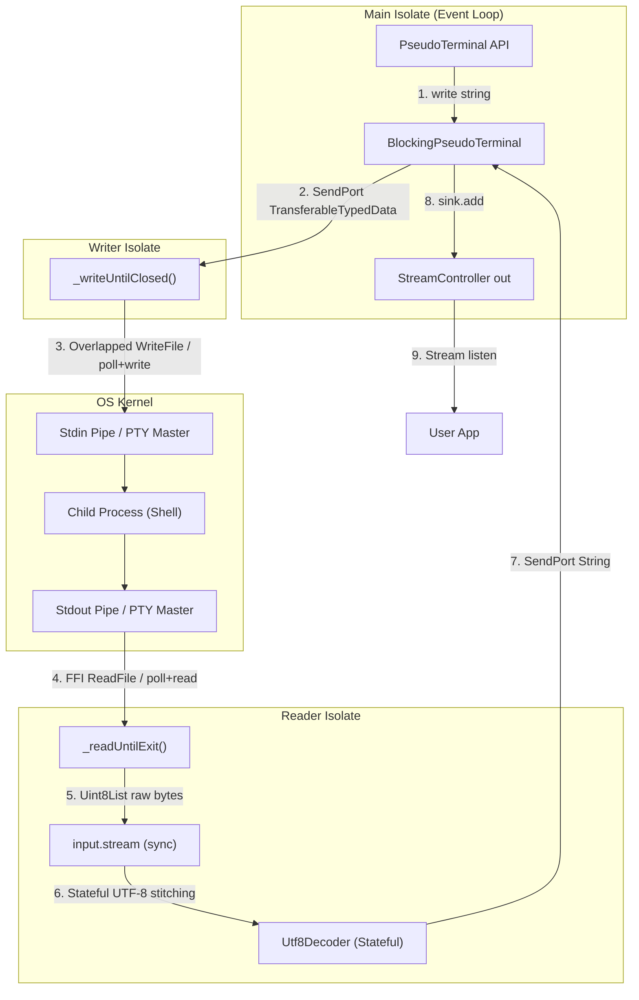
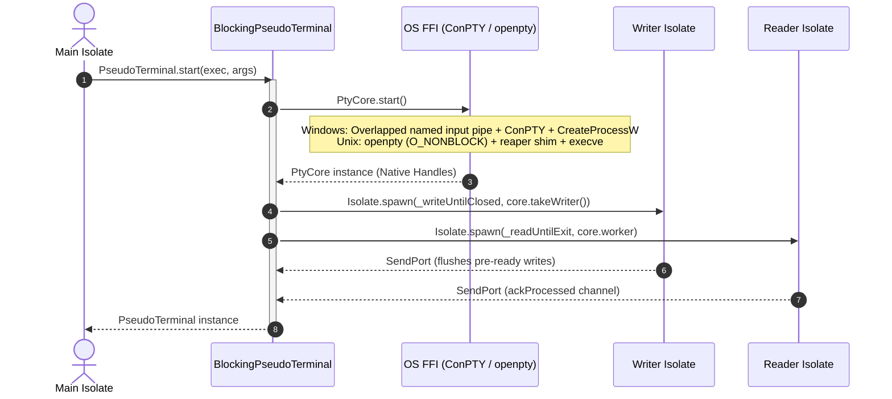
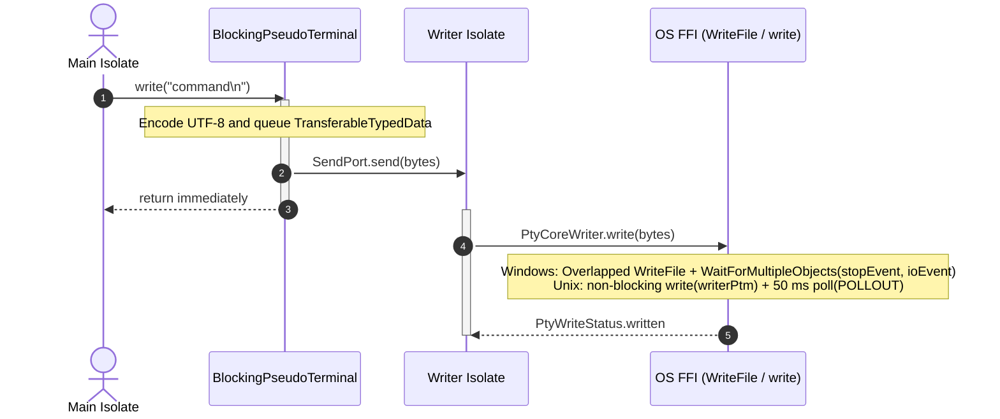
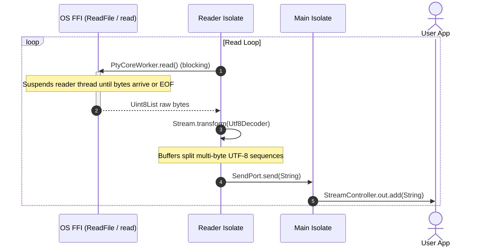
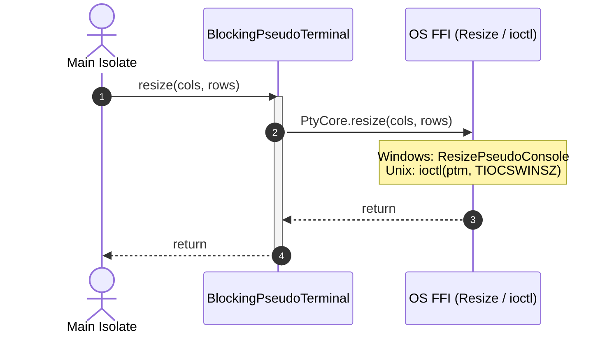
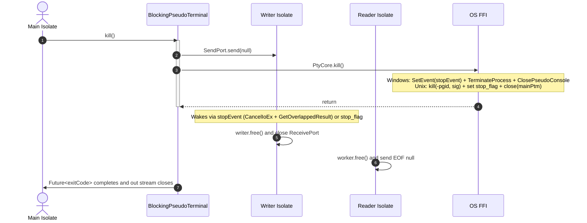

# `package:pty2` System Architecture

## 1. System Design Overview

`package:pty2` manages pseudo-terminal (PTY) lifecycles by calling native OS APIs through Dart FFI. To keep the caller isolate's single-threaded event loop responsive, `BlockingPseudoTerminal` moves blocking native I/O off the main isolate onto three dedicated background isolates:

- The reader isolate (`_readUntilExit`) blocks on PTY output reads and stitches split UTF-8 sequences.
- The writer isolate (`_writeUntilClosed`) drains queued input writes in FIFO order so full OS pipe buffers never block the caller or deadlock `ackProcessed: true` flows.
- The exit-waiter isolate (`_waitForExitCode`) blocks until the child process exits and reports its exit code.

---

## 2. Sequence Diagrams

### 2.1 PTY Open (`PseudoTerminal.start`)

Sets up native FFI structures and pipes, starts the child process inside the PTY, and launches the reader, writer, and exit-waiter isolates.

### 2.2 PTY Send (`write`)

Encodes text to UTF-8 and transfers the bytes asynchronously to the writer isolate in FIFO order without blocking the caller isolate.

### 2.3 PTY Read

The reader isolate waits on the PTY output handle, decodes bytes statefully across multi-byte UTF-8 boundaries, and sends strings back to the main isolate. When `ackProcessed: true`, it pauses after each chunk until the caller acknowledges processing.

### 2.4 PTY Resize

Updates the PTY window dimensions in character cells (and optional viewport pixels on Unix).

### 2.5 PTY Close (`kill` / natural exit)

Stops pending writes, terminates the child process, cancels any blocked writer I/O, and releases native buffers and OS handles once all isolates exit.

